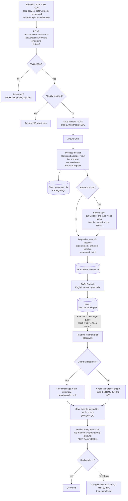
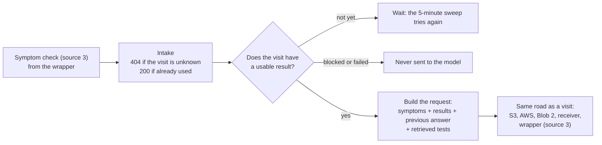

# Patient-360-pilot

AI Service - that turns a patient's LIMS lab results into a plain-language report: bilingual (EN/AR), with rules-based critical alerts and AI-generated explanations + AI Test recommendations.

## How it works, in short

1. The Backend sends one JSON per visit (source: batch, urgent, on-demand) or one symptom check (source: symptom-checker).
2. We check it, save it safely (Blob first, then PostgreSQL) and answer.
3. We prepare the AI request: results without ids, a status and alert per result, the patient tier (which lane: normal or critical), and tests we may recommend.
4. We upload it to S3. AWS (Bedrock) writes the English and Arabic answer to Blob 2.
5. We read that answer, build the final result (plus HTML and the `symptom_flag`: true if the patient may use the symptom
   checker on this visit, false for a fully normal patient or a blocked result) and send it to the Backend wrapper.

## The process



### The symptom check



### The `symptom_flag` (can the patient use the symptom checker?)

Added to every result sent to the Backend. It is decided from the visit's own results when the result is built (not
from whether tests were found).

| Situation | `symptom_flag` |
|---|---|
| Every parameter is normal and there is no descriptive (text) result: a fully normal patient (tier NORMAL) | `false` |
| One or more parameters are high, low or abnormal (tier MILD, MODERATE) | `true` |
| A parameter could not be judged (status text) | `true` (counts as not normal) |
| Any critical parameter (tier CRITICAL) | `true` |
| Normal parameters, plus a descriptive (text) result | `true` (a text result counts as not normal) |
| Only descriptive results, or no result with a value at all | `true` (no data is not "no findings") |
| The AI result was blocked by the guardrail (any tier) | `false` (nothing to check the symptoms against) |
| The result of a symptom check itself (source 3) | `false` (a symptom check is used once) |
| The AI answer was unusable | no result is sent, so there is no flag |

If a symptom check arrives for a visit whose result has `symptom_flag` false, we answer **409 `SYMPTOM_CHECKER_CLOSED`**
and save nothing (the Backend can tell the patient). While the visit has no result yet, the flag is not known, so the
symptom check is accepted and waits for it.

## What runs by itself

| How often | What | Code |
|---|---|---|
| Right after a visit is accepted | Process it (and, for a batch visit, check if a batch is full) | `http_app.py` |
| Every 5 seconds | Upload ready files to S3, deliver ready results to the Backend | `timers.run_work_cycle` |
| Always (if an event queue is set) | Read the "a file was created" events Event Grid writes to the queue, and save each AWS answer | `timers.run_event_cycle` |
| Every 5 minutes | Start full batches, process visits and symptom checks a restart cut short | `timers.run_job_cycle` |
| When a file appears in Blob 2 | Read the AWS answer and prepare the result | `POST /api/v1/patient360/blob-events` |

## Where the data lives

| Place | What is in it |
|---|---|
| Blob 1 (`BLOB_INPUT_CONTAINER`) | `raw/` the JSON as received, `raw/_rejected/` JSON that failed the checks, `processed/` the Bedrock request per visit, batch folders and their JSONL files |
| S3 (one bucket per source) | The file AWS starts from: one JSON per visit, or the JSONL of a batch |
| Blob 2 (`BLOB_OUTPUT_CONTAINER`) | `aws-output-merged/` the final English and Arabic answer written by AWS (batch answers are also split per visit by us) |
| PostgreSQL | Everything as rows: visits, results, the raw and processed JSON versions, AI answers, work queue, batches (see `migrations/001_init.sql`) |

## Folders

| Folder | What is inside |
|---|---|
| `src/patient360/domain/` | Pure rules and builders, no connections: checking the JSON, status and alert, tier and lane, test retrieval, building the AI request and the final result |
| `src/patient360/flow/` | The steps of the process: intake, processing, batching, dispatch, receiving the AI answer, sending the result, the symptom check |
| `src/patient360/adapters/` | The real connections: PostgreSQL, Azure Blob, AWS S3, the Backend wrapper |
| `src/patient360/config/` | Settings from environment variables, and safe logging |
| `src/patient360/prompts/` | The system prompts (`.md`) and the answer schemas (`.json`) per source |
| `migrations/` | The database schema (SQL) |
| `tools/` | The local simulation: a fake Backend wrapper and a script that plays AWS |
| `tests/` | The automatic tests (a real PostgreSQL is used for the adapter tests) |

## Run it

```powershell
uv sync                                  # install
uv run pytest -q                         # all tests (the PostgreSQL ones need the test database on 127.0.0.1:5433)
docker compose up --build                # the whole service with fake Azure, AWS and Backend (see tools/README.md)
uv run python tools/simulate.py          # in a second terminal: plays the Backend and AWS, prints PASS or FAIL
```

Settings are environment variables: see `.env.example` (never commit a real `.env`). Start-up command:
`uvicorn --factory patient360.main:create_app_from_env`. Create or update the database with `python -m patient360.migrate`.

## Function reference

For every file: what each function does and what it returns. Methods are written `Class.method`. A row marked
"(helper)" is a small private function used inside the same file.

### `domain/payload/ai_answer.py`
Describes the shape of the answer that comes back from the AI model (English and Arabic); a wrong shape is refused.

| Function | What it does | Output |
|---|---|---|
| `_Answer` | (helper) Base class for all answer shapes. Strict about types, and silently drops keys it does not know. | an object with only the known keys |
| `EnAr` | A pair of texts: `en` (English) and `ar` (Arabic). | an object with `en` and `ar` |
| `Advisory` | A short advice made of a `level` and a `message`, each in English and Arabic. | an object with `level` and `message` |
| `Recommendation` | One suggested test: name, priority, reason, timing, guideline, advisory. Symptom checks may add `change_type` and `explanation`. | an object with the fields above |
| `AiAnswer` | The whole answer: summary, simple summary, critical alerts, note and a list of recommendations. | an object with those fields |
| `AiAnswer.for_backend()` | Turns the answer into plain data for the Backend, leaving out any empty (None) fields. | A dictionary ready to send. |

### `domain/payload/models.py`
Describes exactly what the Backend must send us; any unknown or wrongly typed field is rejected.

| Function | What it does | Output |
|---|---|---|
| `Strict` | (helper) Base class: unknown keys are errors and types are not guessed (a text "5" is not a number). | an object that is checked strictly |
| `HistoryPoint` | One earlier result of a parameter: visit id, date and value. | an object with `history_visit_id`, `history_date`, `history_value` |
| `Reference` | The lab's normal range: `low`, `high` and a `range` text. | an object with `low`, `high`, `range` |
| `Critical` | The danger limits: `low`, `high` and a `range_text`. | an object with `low`, `high`, `range_text` |
| `Result` | One measured parameter: id, name, date, value, unit, reference, lab flag (H or L), critical limits, remark, history. | an object with those fields |
| `Test` | One test with its list of parameter results. | an object with `test_id`, `test_name`, `test_remark`, `results` |
| `Test._parameters_are_unique()` | (helper) Checks that no parameter appears twice inside one test. | nothing returned; raises an error if a parameter repeats |
| `DescriptiveResult` | A test whose result is free text instead of numbers. | an object with id, name, date, `text`, history |
| `PreparationAnswer` | The patient's answer to one preparation question (for example fasting). | an object with `preparation_id`, `preparation_name`, `answer` |
| `Patient` | The patient's age in whole days (0 to 60000, counted by the Backend) and sex (1 male, 2 female). | an object with `age_days`, `sex` |
| `AgeDays (type)` | A whole number of days from 0 (newborn) to 60000, sent as a number or as whole-number text ("19200"); decimals, negatives and other text are refused. | a checked number |
| `VisitPayload` | A full lab visit (source 1 urgent, 2 batch, 4 on-demand): ids, company, patient, tests, text results, answers. | an object with those fields |
| `VisitPayload._tests_are_unique()` | (helper) Checks no test id appears twice, in the numeric tests or in the text results. | nothing returned; raises an error if a test repeats |
| `SymptomPayload` | A symptom check (source 3): ids, the patient's symptom text (1 to 500 characters) and when it was received. | an object with those fields |

### `domain/payload/validate.py`
The front door for incoming data: turns raw bytes into either a good payload or a list of errors.

| Function | What it does | Output |
|---|---|---|
| `MAX_LOC_PART (constant)` | Longest piece (60 characters) of a field name kept in an error, because the sender chooses those names. | the number 60 |
| `MODELS (constant)` | The table that picks the shape by `source`: 1, 2 and 4 use a visit, 3 uses a symptom check. | a read-only table |
| `Valid` | Holds a payload that passed every check. | an object with `payload` |
| `Invalid` | Holds the list of errors. It never contains the patient's values. | an object with `errors` |
| `_error(loc, msg, kind)` | (helper) Builds one error entry: where it is, what is wrong, and its type. | A dictionary with `loc`, `msg`, `type`. |
| `_reject_constant(name)` | (helper) Called when the JSON contains NaN or Infinity, which are not allowed. | nothing returned; always raises an error |
| `validate_payload(raw)` | Reads the bytes as JSON, picks the shape by `source`, and checks it strictly. | A `Valid` object, or an `Invalid` object with the errors. |

### `domain/payload/values.py`
Small helpers for reading numbers and cleaning text.

| Function | What it does | Output |
|---|---|---|
| `as_whole_number(value)` | Turns whole-number text ("19200", " 28 ") into a number; anything else is returned as it is. | A number, or the value unchanged. |
| `parse_numeric(value)` | Removes spaces and reads the number at the start. Refuses "0,5" style commas, titres like "1:64", dates and ranges like "5-10". | A whole number or decimal, or None if it is not a plain number. |
| `remove_empty_values(value)` | Goes through lists and dictionaries and removes None, empty text and empty containers. Keeps 0 and False. | The cleaned data, or None if nothing is left. |
| `_TextOnly` | (helper) A reader for HTML that keeps only the visible text and adds line breaks for tags like `<br>` and `<p>`. | an object with the collected text `parts` |
| `_TextOnly.__init__()` | (helper) Starts an empty list of text parts and a counter for hidden sections. | nothing returned |
| `_TextOnly.handle_starttag(tag, attrs)` | (helper) On an opening tag: starts hiding for script or style, or adds a line break for block tags. | nothing returned |
| `_TextOnly.handle_endtag(tag)` | (helper) On a closing tag: stops hiding for script or style, or adds a line break for block tags. | nothing returned |
| `_TextOnly.handle_data(data)` | (helper) Keeps a piece of text unless it is inside script or style. | nothing returned |
| `html_to_plain_text(value)` | Turns HTML into plain text: tags removed, line breaks kept, entities decoded, spaces tidied. | Plain text; a non-text value comes back unchanged. |

### `domain/rules/classify.py`
Decides the patient's tier (how serious) and the model lane (which AI model is used).

| Function | What it does | Output |
|---|---|---|
| `LANE_BY_TIER (constant)` | The lane table: NORMAL and MILD use the "normal" lane (cheaper model); MODERATE and CRITICAL use the "critical" lane (stronger model). | a read-only table |
| `MILD_MAX (constant)` | 1 to 3 parameters that are not normal means MILD; more than 3 means MODERATE. | the number 3 |
| `has_value(row)` | Checks that a result row has a value that is not empty or blank. | True or False. |
| `decide_tier(result_rows, descriptive_count=0)` | Looks at rows with a value: any critical gives CRITICAL; otherwise counts not-normal rows plus text results. No numeric rows at all gives MODERATE. | One of NORMAL, MILD, MODERATE, CRITICAL. |
| `lane_for_tier(tier)` | Looks up the lane for a tier in the lane table. | "normal" or "critical". |
| `symptom_checker_open(tier, blocked=False)` | Decides the `symptom_flag`: closed for a fully NORMAL patient and when the AI result was blocked. | True (the patient may type symptoms) or False. |

### `domain/rules/dispatch.py`
Rules for which kind of visit goes to AWS first and how long to wait before trying again.

| Function | What it does | Output |
|---|---|---|
| `SOURCE_PRIORITY (constant)` | Send order, smaller first: urgent 0, symptom-checker 1, on-demand 2, batch 3. | a read-only table |
| `RETRY_DELAYS_S (constant)` | Waits in seconds after the 1st to 4th failure: 10, 30, 120, 600. The 5th failure gives up. | the list 10, 30, 120, 600 |
| `retry_after(failed_attempts)` | Gives the wait time after that many failures in a row. Raises an error if the count is below 1. | A wait time, or None meaning give up. |

### `domain/rules/logic.py`
Decides if a result is high, low or normal, reads word results, and checks danger (critical) limits.

| Function | What it does | Output |
|---|---|---|
| `NOT_SET_PAIRS (constant)` | Lab "no range" markers, valid only as a pair: (0, 0), (-1, 9999) or (-1, 99999999). A lone -1 is a real number. | a list of pairs |
| `CRITICAL_NOT_SET_LOWS` / `CRITICAL_NOT_SET_HIGHS (constant)` | "No danger limit" markers: lows -1, -9999, -99999 and highs 9999, 99999, 999999. They count only when both sides match. | two sets of numbers |
| `NEGATIVE_PATTERNS` / `POSITIVE_PATTERN (constant)` | Word patterns for negative results ("negative", "not detected", "non reactive") and positive ones ("positive", "detected"). | text patterns |
| `reference_bounds(low, high)` | Reads the lab's low and high limits as numbers. | A pair (low, high), or (None, None) when the lab marked "no range". |
| `parse_text_range(text)` | Reads a range from words such as "6.7 - 22.4", "< 5.7" or "up to 30"; swaps a reversed pair. | A pair (low, high); a missing side is None; (None, None) if unreadable. |
| `classify_result(value, low, high)` | Compares the number with the limits. A missing limit is never compared. | "low", "high", "normal", or None if it cannot be judged. |
| `normalise_text(text)` | Trims extra spaces and makes the text lower case. | A tidy lower-case text ("" for None). |
| `text_polarity(text)` | Reads a word result as negative or positive. Negative phrases are removed before looking for positive words. | "negative", "positive", "conflicting", or None. |
| `classify_qualitative(value, expected_text)` | Judges a word result: negative is normal, positive is abnormal, otherwise normal only if it equals the expected text. | "normal", "abnormal" (no direction), or None. |
| `lab_flag_status(flag)` | Turns the lab's own flag into a status: H is high, L is low. | "high", "low", or None. |
| `critical_bounds(low, high)` | Reads the danger limits as numbers. Both sides being "no limit" markers means no danger limits at all. | A pair (low, high), or (None, None) when both are markers. |
| `_coherent_sides(bounds, ref_low, ref_high)` | (helper) For a normal value, checks which danger limit makes sense next to the normal range. | A pair of True or False: (low side ok, high side ok). |
| `critical_breach(value, bounds, *, status, ref_low, ref_high)` | Checks if the value touches a danger limit (equal counts). A high value is only checked against the high limit, and low against low. | "low", "high", or None. |
| `alert_level_for(status)` | Maps a status to an alert level: critical, abnormal or high/low, normal. | "CRITICAL", "MEDICAL_ATTENTION", "NORMAL", or None. |

### `domain/rules/packages.py`
The shape of a test package (a bundle of tests) and how packages are shown in the AI input. The rule that chooses packages is not written yet.

| Function | What it does | Output |
|---|---|---|
| `Package` | One test package: id, English name, sex it fits (1 male, 2 female, 3 both), age range in years, and its test ids. | an object with those fields |
| `package_entries(packages, test_names)` | Turns the chosen packages (best first) into entries with a name and the tests inside. Unknown test names show the id. | A list of dictionaries with `package_name` and `tests`. |

### `domain/rules/retrieval.py`
A simple fixed stand-in for the search step: picks catalogue tests from the categories of parameters that are not normal.

| Function | What it does | Output |
|---|---|---|
| `MAX_RETRIEVED_TESTS (constant)` | The most tests that can be picked in one go. | the number 50 |
| `CatalogueTest` | A test in the catalogue: id, English name, description, categories, and whether it is active. | an object with those fields |
| `CatalogueParameter` | A parameter in the catalogue: id, categories, and whether it is active. | an object with those fields |
| `build_catalogue_maps(active_category_ids, tests, parameters)` | Builds the two lookups from database rows. Inactive tests, categories and parameters are ignored when picking. | A pair: parameter to its categories, and category to its tests. |
| `_same(name)` | (helper) Tidies spaces and ignores capital letters so two test names can be compared. | A comparable text. |
| `select_retrieved_tests(rows, parameter_categories, tests_by_category, performed_test_names, max_tests=50, include_normal=False)` | Picks tests from the categories of not-normal parameters (critical first), skipping tests already done, up to the limit. All normal gives nothing. | A list of dictionaries with `test_name` and `test_description`. |
| `select_retrieved_tests.categories_of(selected)` | (helper) Collects every category of the given rows. A parameter can be in several categories. | A set of category ids. |

### `domain/common/blob_paths.py`
The one place that builds every file path in Azure Blob and S3 (folders by source, lane and date).

| Function | What it does | Output |
|---|---|---|
| `SOURCES (constant)` | The allowed sources: on-demand, urgent, batch, symptom-checker. | a set of names |
| `LANES (constant)` | The allowed lanes: normal and critical. | a set of names |
| `blob_day(moment)` | Gets the date folder for a time. The time must have a time zone; the date is the UTC date. | A date. |
| `_check(source, lane=None)` | (helper) Checks the source, and the lane if given, are allowed. | nothing returned; raises an error if not |
| `_name(value, what)` | (helper) Checks a name has only letters, digits, `_` or `-` (so it cannot escape its folder). | The same name, or an error. |
| `_key(idempotency_key)` | (helper) Checks the idempotency key (the unique visit id) is a safe name. | The same key, or an error. |
| `_day(day)` | (helper) Writes a date as `yyyy/MM/dd`. | A text such as "2026/10/25". |
| `_batch_rules(source, batch_id)` | (helper) A batch file must have a batch id; any other source must not. | nothing returned; raises an error if broken |
| `raw_path(source, day, idempotency_key)` | Path of the JSON exactly as the Backend sent it. | A path text. |
| `rejected_path(source, day, visit_id)` | Path of a payload that failed checks, named by visit id (which must be a positive whole number). | A path text. |
| `rejected_unknown_path(day, raw_sha256_hex)` | Path of a rejected payload with no usable source or visit; named by the first 16 characters of a hash. | A path text. |
| `processed_path(source, lane, day, idempotency_key, batch_id=None)` | Path of the JSON prepared for the AI; a batch visit goes in its batch folder. | A path text. |
| `batch_jsonl_path(lane, day, batch_id)` | Path of the batch file for AWS (one line per visit, up to 100). | A path text. |
| `merged_output_path(source, lane, day, idempotency_key, batch_id=None)` | Path of the final merged result (English and Arabic) of one visit. | A path text. |
| `merged_output_jsonl_path(lane, day, batch_id)` | Path of the merged results of a whole batch. | A path text. |
| `MergedOutput` | Describes a merged result file read back from its path: kind, source, lane, day, key, batch id. | an object with those fields |
| `parse_merged_output_path(path)` | Works out what a merged-result path is (visit, batch file, or batch visit). | A `MergedOutput`, or None if it is not ours or the date is fake. |
| `s3_processed_key(source, lane, day, idempotency_key, batch_id=None)` | Builds the file key inside the S3 bucket. A batch uses its batch file and has no idempotency key. | A key text. |

### `domain/common/blob_events.py`

| Name | What it does (simple) | What you get back |
|---|---|---|
| `blob_paths_from_events(events)` | Takes one Event Grid event or a list, keeps the "blob created" ones and returns the path inside the container. A body that is not an event raises an error. | A list of paths. |

### `domain/common/compat.py`
Makes `frozendict` (a dictionary that cannot be changed) work on older Python versions.

| Function | What it does | Output |
|---|---|---|
| `frozendict` | Uses the built-in one on Python 3.15 and newer; on older versions uses a read-only dictionary view instead. | a read-only dictionary type |

### `domain/common/ids.py`
Makes the visit's unique key and the batch names.

| Function | What it does | Output |
|---|---|---|
| `make_idempotency_key(key, *, patient_id, visit_id)` | Signs "patient\|visit" with a secret key, so the same visit always gives the same key and it cannot be guessed. | A 32-character text. |
| `format_batch_id(lane, number)` | Builds a batch name from the lane and a number, such as `normal_000001`. Raises an error for a bad lane or number below 1. | A batch id text. |

### `domain/common/timing.py`
Measures how long each step of the pipeline takes, so slow steps can be found later.

| Function | What it does | Output |
|---|---|---|
| `PHASES (constant)` | The allowed step names: validate, process, queue_wait, aws_round_trip, post_process, deliver. | a list of names |
| `PhaseTiming` | One measurement: step name, start time and length in milliseconds. | an object with `phase`, `started_at`, `duration_ms` |
| `_utc_now()` | (helper) The current time in UTC. | A date and time. |
| `PhaseTimer` | Collects the timings of one record and attempt. | an object with a `timings` list |
| `PhaseTimer.__init__(clock, now)` | Sets up the stopwatch and the clock (they can be swapped in tests) and an empty list. | nothing returned |
| `PhaseTimer.measure(phase)` | Used with `with`: times the block inside it and saves the result, even if the block fails. Unknown step names raise an error. | nothing returned; adds a `PhaseTiming` to `timings` |

### `domain/builders/ai_input.py`
Turns a received visit into the JSON the AI reads, plus the rows the service keeps for each result.

| Function | What it does | Output |
|---|---|---|
| `AiInput` | A frozen (never changed) holder for everything built from one visit. | An object with the AI JSON, the result rows, the descriptive rows and the tests already done. |
| `SOURCE_NAMES (constant)` | Maps the source number (1 to 4) to its name: urgent, batch, symptom-checker, on-demand. | A name for each source number. |
| `SEX_NAMES (constant)` | Maps the sex number (1 or 2) to the word Male or Female. | A word for each sex number. |
| `_history(points, plain_text)` | (helper) Copies the past values of a result into the shape the AI gets; can strip HTML tags from text values. | A list of date and value pairs. |
| `_result(test, raw)` | (helper) Works out the status, alert and critical direction of one result, then builds its AI entry and its row. | A pair: the entry for the AI JSON and the row with ids, status and alert. |
| `build_ai_input(raw)` | Turns a received visit into the JSON for the AI and one row per result. | An object with the AI JSON, the result rows, the descriptive rows and the tests already done. |

### `domain/builders/backend_output.py`
Builds the final result that is sent back to the Backend system.

| Function | What it does | Output |
|---|---|---|
| `build_backend_output(patient_id, visit_id, source, rows, ai, ..., symptom_flag)` | Groups result rows by test, adds the AI answer, optional packages, the HTML page and the `symptom_flag`. | The result as a dictionary: ids, symptom_flag, tests with statuses and alerts (`alert` is `null` for a text value), the AI part and the html. No descriptive results. |

### `domain/builders/blocked.py`
Handles answers the safety filter (guardrail) blocked: the Backend gets one fixed message, never what the model wrote.

| Function | What it does | Output |
|---|---|---|
| `GUARDRAIL_ACTION_KEY (constant)` | The name of the field where AWS says what the guardrail did. | A text name. |
| `TRACE_KEY (constant)` | The name of the field holding the guardrail's detailed trace. | A text name. |
| `BLOCKED_MESSAGES (constant)` | The only two messages ever shown for a block (input refused or output refused), in English and Arabic. | A dictionary of fixed messages. |
| `_guardrail_action(record)` | (helper) Finds the guardrail action at the top of the record or inside its per-language metadata. | The action text, or nothing found. |
| `_actions(node, path)` | (helper) Walks the whole trace and finds every action (such as BLOCKED or ANONYMIZED) with the keys leading to it. | A stream of key path and action pairs. |
| `is_blocked(record)` | Decides if the answer was really blocked. Personal data only being hidden is not a block; no usable trace counts as blocked. | True or False. |
| `blocked_reason(record)` | Says whether the block was on what we sent (input) or on what the model wrote (output). | The text "input" or "output". |
| `is_blocked_ai(ai)` | Checks if an AI answer looks like a blocked one (everything empty except the summary). | True or False. |
| `blocked_ai(record)` | Builds the AI part for a blocked result: only the fixed summary is filled, the rest is empty. | A dictionary with the summary and four empty parts. |

### `domain/builders/html_report.py`
Builds the English and Arabic HTML that the Backend uses for the PDF report.

| Function | What it does | Output |
|---|---|---|
| `LABELS (constant)` | The section headings in English and Arabic. | A dictionary of headings. |
| `WRAPPER (constant)` | The outer div for each language; Arabic is set right-to-left. | A dictionary of HTML templates. |
| `_text(node, lang)` | (helper) Takes the text of one language from a bilingual value and makes it safe for HTML. | A safe text, or an empty text. |
| `_test_names(ai, lang, arabic_names, with_reasons)` | (helper) Lists the recommended test names, skipping removed ones, with the reason if asked. | A list of text lines, one per test. |
| `build_html(ai, arabic_names, with_reasons)` | Builds the page: the summary, then one bullet per recommended test, for each language. | A dictionary with an "en" page and an "ar" page. |

### `domain/builders/model_input.py`
Builds the request sent to the AI model (Bedrock) for one visit.

| Function | What it does | Output |
|---|---|---|
| `ANTHROPIC_VERSION (constant)` | The fixed version label Bedrock needs for the Claude model. | A text label. |
| `MAX_TOKENS (constant)` | The longest answer the model may write: 2048 tokens (small pieces of text). | The number 2048. |
| `build_model_input(system_prompt, output_schema, processed)` | Packs the prompt, the visit JSON and the answer format. Refuses an empty prompt or format. | The request as a dictionary. Raises an error if the prompt or schema is empty. |

### `domain/builders/symptom_ai_input.py`
Builds the JSON for the symptom checker: the patient's own words, the stored visit and the earlier AI answer.

| Function | What it does | Output |
|---|---|---|
| `keep_english_only(node)` | Goes through any data and turns every English and Arabic text pair into just the English text. | The same data with only English texts. |
| `build_symptom_ai_input(request, stored_visit_ai_json, stored_ai)` | Joins the symptoms, the saved visit JSON and the earlier AI answer (without packages, English only). | The JSON for the AI as a dictionary, with empty values removed. |

### `config/settings.py`
Reads all settings from environment variables and checks them in one go.

| Function | What it does | Output |
|---|---|---|
| `REQUIRED (constant)` | The settings that must always be given: database, blob containers and the secret for idempotency keys. | A list of setting names. |
| `BLOB_ACCESS (constant)` | The two ways to reach blob storage; at least one must be given. | A list of two setting names. |
| `BACKEND_SETTINGS (constant)` | The seven Backend settings; give all of them or none. | A list of setting names. |
| `MIN_BATCH_SIZE, MAX_BATCH_SIZE (constants)` | The allowed batch size is 100 to 50000 visits. | Two numbers. |
| `MIN_SECRET_LENGTH (constant)` | The idempotency secret must have at least 16 characters. | The number 16. |
| `S3_SETTINGS (constant)` | Maps each source to the setting that names its S3 bucket. | A dictionary of source to setting name. |
| `SettingsError` | The error raised when settings are missing or wrong; its message lists names only, never values. | An error holding a text of problems. |
| `BackendSettings` | Holds how to reach the Backend: address, caller headers and login (secrets are hidden when printed). | An object with the address, caller details and login (username and password). |
| `Settings` | The one frozen object holding every checked setting. | An object with all the settings. |
| `Settings fields` | Groups: app mode and logging, database, blob storage, AWS, Backend, timers, batch size, request limit and API key. | Not a function; it lists the setting groups. |
| `load_settings(env)` | Reads the settings (from the environment by default), checks all of them and stops with every problem listed. | A `Settings` object. Raises `SettingsError` on any problem. |
| `load_settings.choice(...)` | (helper) Reads a setting that must be one of a few allowed words, with a default. | The chosen word. |
| `load_settings.number(...)` | (helper) Reads a number setting and checks it is within its range, with a default. | The number. |

### `config/logging_setup.py`
Sets up logging so that only a short safe list of fields is ever written, so patient data cannot leak.

| Function | What it does | Output |
|---|---|---|
| `ALLOWED_FIELDS (constant)` | The only log fields allowed through; anything else is dropped at every level. | A fixed set of field names. |
| `_only_allowed(logger, method_name, event_dict)` | (helper) Removes every field from a log line that is not on the allowed list. | The log line with only allowed fields. |
| `configure_logging(level, log_format, stream)` | Sets the log level and format (json or console) and adds time, level and the filter. | Nothing returned. Raises an error for an unknown level or format. |

### `ports.py`
Lists what the core flow needs from the outside world (storage, S3, Backend, database). Real versions must follow these.

| Function | What it does | Output |
|---|---|---|
| `BlobUnavailable` | The error for when blob storage cannot be reached; the flow then uses PostgreSQL. | An error. |
| `BlobStore.put(path, data)` | Creates the file in blob storage. | False if the file already exists, else True. Raises `BlobUnavailable`. |
| `BlobStore.get(path)` | Reads the file from blob storage. | The file bytes, or nothing if missing. Raises `BlobUnavailable`. |
| `S3Unavailable` | The error for when S3 is unreachable or refuses the file; the sender tries again later. | An error. |
| `S3Store.put(source, key, data)` | Uploads a file to the S3 bucket of that source, which starts the AWS work. | Nothing returned. Raises `S3Unavailable`. |
| `BackendUnavailable` | The error for a timeout, no connection, 429 or 5xx from the Backend; trying again may work. | An error. |
| `BackendRejected` | The error for a 4xx answer (not 429); the same body would fail again, so no retry. | An error. |
| `BackendClient.post_result(body)` | Sends one result to the Backend in one call. | Nothing returned. Raises `BackendUnavailable` or `BackendRejected`. |
| `DeliveryUnit` | One result ready to send to the Backend. | An object with the visit id, source, failed tries so far and the kind (visit or symptom). |
| `StoredVisit` | A visit as saved in the database. | An object with the visit id, idempotency key, source id, time received and raw bytes. |
| `StoredSymptomCheck` | A symptom check as saved in the database. | An object with the visit id, time received and raw bytes. |
| `BatchVisit` | One visit inside a batch. | An object with its idempotency key and the saved model request. |
| `ClaimedBatch` | A batch taken by a worker. | An object with the batch id, its visits and the database time it was created. |
| `WorkUnit` | One thing to upload to S3: a visit file, a symptom check file or a whole batch. | An object with source, lane, time, where to read from, failed tries and the ids. |
| `Catalogue.parameter_categories()` | Gives the categories of each lab parameter (active ones only). | A map from parameter id to its category ids. |
| `Catalogue.tests_by_category()` | Gives the tests listed under each category. | A map from category id to its tests. |
| `Catalogue.test_names_ar()` | Gives the Arabic name of every test, active or not. | A map from English test name to Arabic name. |
| `VisitStore.visit_exists(visit_id)` | Checks if a visit is already saved. | True or False. |
| `VisitStore.stored_visit(visit_id)` | Loads a visit as it was received. | A `StoredVisit`. |
| `VisitStore.save_processed(visit_id, tier, model_input, read_from)` | In one transaction saves the tier, the model request and the stage "processed", and adds a waiting work row. | Nothing returned. |
| `VisitStore.save_visit(payload, raw, idempotency_key, received_at, read_from)` | Saves the visit, its tests, results and raw bytes in one transaction. | Nothing returned. |
| `VisitStore.claim_batch(lane, size)` | Takes the oldest waiting batch visits of a lane when enough wait, and makes a batch row. | A `ClaimedBatch`, or nothing if too few wait. |
| `VisitStore.claim_next_work(now)` | Takes the next upload job, best source first and oldest first, so only one worker gets it. | A `WorkUnit`, or nothing. |
| `VisitStore.model_input_of(unit)` | Loads the saved model request of a visit or symptom check. | The request as a dictionary. |
| `VisitStore.batch_model_inputs(batch_id)` | Loads every visit of a batch with its saved request, in batch order. | A list of `BatchVisit`. |
| `VisitStore.mark_sent(unit)` | Records that the unit was sent to AWS (and the batch as submitted). | Nothing returned. |
| `VisitStore.mark_failed_attempt(unit, error_type, retry_at)` | Counts a failed upload and sets a retry time; no time means give up and mark failed. | Nothing returned. |
| `VisitStore.visits_waiting_for_processing(received_before)` | Finds visits stuck at "received" older than the given time (cut short by a restart). | A list of visit ids, oldest first. |
| `VisitStore.find_visit(idempotency_key)` | Finds the visit that owns a key (AWS calls it recordId). | A `StoredVisit`, or nothing. |
| `VisitStore.has_output(visit_id, analysis)` | Checks if the AWS output was already saved, since events can arrive twice. | True or False. |
| `VisitStore.save_output(visit_id, internal_output, public_output, analysis)` | Saves both output versions and the answer rows, and moves the stage to post-processing. | Nothing returned. |
| `VisitStore.mark_output_failed(visit_id, error_type, analysis)` | Marks the stage "failed" because the AWS output could not be used. | Nothing returned. |
| `VisitStore.stored_symptom_check(visit_id)` | Loads the symptom check of a visit as received. | A `StoredSymptomCheck`. |
| `VisitStore.visit_ai_answer(visit_id)` | Loads the AI answer saved for the visit (English and Arabic). | The AI answer as a dictionary, or nothing if none yet. |
| `VisitStore.save_symptom_processed(visit_id, model_input, read_from)` | Saves the symptom model request, sets the stage "processed_symptom" and adds a waiting work row. | Nothing returned. |
| `VisitStore.symptoms_waiting_for_processing(received_before)` | Finds symptom checks stuck at "received_symptom", cut short or waiting for the visit result. | A list of visit ids, oldest first. |
| `VisitStore.set_batch_status(batch_id, status)` | Sets a batch to completed, partially completed or failed. | Nothing returned. |
| `VisitStore.claim_next_delivery(now)` | Takes the next result to send to the Backend, best source first, one worker per result. | A `DeliveryUnit`, or nothing. |
| `VisitStore.public_output_of(unit)` | Loads the result exactly as the Backend should get it. | The saved public output as a dictionary. |
| `VisitStore.mark_delivered(unit)` | Records that the result reached the Backend. | Nothing returned. |
| `VisitStore.mark_delivery_failed_attempt(unit, error_type, retry_at)` | Counts a failed delivery and sets a retry time; no time means give up and mark failed. | Nothing returned. |
| `VisitStore.set_batch_read_from(batch_id, read_from)` | Records where the batch's visits are read from (blob or PostgreSQL). | Nothing returned. |
| `VisitStore.symptom_check_state(visit_id, patient_id)` | Checks if a symptom check can be accepted for this visit and patient, including whether the visit's saved result closed the checker. | One of "no_visit", "already_used", "closed" or "ok". |
| `VisitStore.save_symptom_check(payload, raw, received_at, read_from)` | Saves a received symptom check. | Nothing returned. |
| `VisitStore.save_rejected(source_id, raw, errors, blob_path)` | Saves a request that failed checks, with its errors. | Nothing returned. |

### `services.py`
Holds the whole running service as one object.

| Function | What it does | Output |
|---|---|---|
| `Services` | A frozen holder for the settings, database and the flow parts, built once at start-up for the web routes and timers. | An object with settings, db, store, intake, processor, symptom processor, batch trigger, dispatcher, receiver and sender (sender is empty without Backend settings). |

### `prompts/__init__.py`
Loads the prompt text and output format for each source from the prompt files.

| Function | What it does | Output |
|---|---|---|
| `_read(name)` | (helper) Reads one text file from the prompts folder as UTF-8. | The file text. |
| `_prompt_and_schema(name)` | (helper) Reads the prompt file and its schema file for one name. | A pair: prompt text and schema dictionary. |
| `PROMPT_AND_SCHEMA_BY_SOURCE (constant)` | Loads once, at import, the prompt and schema for urgent, on-demand, batch and symptom-checker. | A dictionary from source name to a prompt and schema pair. |

### `prompts/` files
The text files that the code above loads. Edit the files, not the code.

| Function | What it does | Output |
|---|---|---|
| `urgent.md` | The instructions for the AI on urgent visits: summaries plus follow-up tests. | Prompt text. |
| `on_demand.md` | The instructions for on-demand visits; a copy of the urgent one so it can change apart. | Prompt text. |
| `batch.md` | The instructions for visits handled in a batch: summaries plus follow-up tests. | Prompt text. |
| `symptom_checker.md` | The instructions for checking if the patient's symptoms change the earlier AI analysis. | Prompt text. |
| `schemas/` | One JSON file per source (urgent, on_demand, batch, symptom_checker) giving the exact shape of the AI answer. | JSON answer formats. |

### `flow/intake.py`
Receives a visit sent by the Backend, checks it, saves it safely and decides the answer.

| Function | What it does | Output |
|---|---|---|
| `Accepted` | Class: a new visit was saved (the web answer is 202). | An object with visit_id, idempotency_key (the secret unique id) and source_id. |
| `Duplicate` | Class: we already have this visit (answer 200). | An object with visit_id. |
| `Rejected` | Class: the payload is not valid (answer 422). | An object with the list of errors, never the input itself. |
| `VisitNotFound` | Class: a symptom check arrived for a visit we do not have (answer 404). | An object with visit_id. |
| `SymptomCheckerClosed` | Class: a symptom check arrived for a visit whose result has `symptom_flag` false (answer 409). | An object with visit_id. |
| `TooLarge` | Class: the request is bigger than the allowed size (answer 413). | An object with size and limit. |
| `SYMPTOM_CHECKER (constant)` | Source number 3 means a symptom check instead of a normal visit. | The number 3. |
| `_peek(raw)` | (helper) Tries to read the source number and visit id from a payload that failed the checks. | A pair (source, visit_id), each one a number or None. |
| `Intake.__init__(store, blobs, secret, now, max_bytes)` | Keeps the database, file storage, secret key, clock and size limit. | Nothing returned. |
| `Intake.receive(raw)` | Checks size, validates, spots duplicates, saves raw file to Blob and database, then answers. | One of Accepted, Duplicate, Rejected, VisitNotFound, SymptomCheckerClosed or TooLarge. |
| `Intake._save_raw_to_blob(source, key, raw, received_at)` | (helper) Puts the raw file in Blob storage; if Blob is down, the database copy is used. | The text "blob" or "postgresql" (where it can be read from). |
| `Intake._reject(raw, errors, received_at)` | (helper) Saves a bad payload in a rejected folder and records the rejection in the database. | A Rejected object with the errors. |

### `flow/process.py`
Turns a received visit into the full request for the AI model, picks its urgency and lane, and stores it.

| Function | What it does | Output |
|---|---|---|
| `BATCH (constant)` | Source number 2 means a batch visit, sent to AWS together with others. | The number 2. |
| `STUCK_AFTER (constant)` | A visit still "received" after 5 minutes is treated as cut short by a restart. | A 5-minute time span. |
| `Processed` | Class: the result of processing one visit. | An object with visit_id, tier (urgency level), lane, and read_from. |
| `write_model_input(blobs, path, model_input)` | Saves the AI request to Blob; if Blob is down the database copy is used instead. | The text "blob" or "postgresql". |
| `Processor.__init__(store, catalogue, blobs, prompts)` | Keeps the database, test catalogue, file storage and the prompts for each source. | Nothing returned. |
| `Processor.process(visit_id)` | Builds AI input, decides tier and lane, adds suggested tests, builds the AI request and saves it. | A Processed object; the request is saved in the database (and Blob, except for batch visits). |
| `process_stuck_visits(store, processor, now)` | Every 5 minutes, processes visits that were accepted but never processed. Safe to run twice. | A list of Processed objects. |

### `flow/batching.py`
Groups waiting visits into full batches (100 by default) per lane and writes the batch files.

| Function | What it does | Output |
|---|---|---|
| `LANES (constant)` | The two lanes that make batches: normal and critical. | The pair "normal", "critical". |
| `CreatedBatch` | Class: one batch that was made. | An object with batch_id, lane and read_from. |
| `_dump(document)` | (helper) Turns a document into one line of JSON, keeping non-English letters. | A one-line text. |
| `build_jsonl(visits)` | Builds the file for AWS: one line per visit with its record id and AI request. | A text with one JSON line per visit. |
| `BatchTrigger.__init__(store, blobs, size)` | Keeps the database, file storage and the batch size. | Nothing returned. |
| `BatchTrigger.run()` | For each lane, keeps claiming full batches from the database and writing them until none is left. | A list of CreatedBatch objects. |
| `BatchTrigger._write(lane, claimed)` | (helper) Writes one file per visit and the JSONL file last into Blob, then records where it is readable from. | A CreatedBatch object; read_from saved in the database. |

### `flow/dispatch.py`
Takes the next ready item (best source first) and uploads it to S3, which starts the AWS automation.

| Function | What it does | Output |
|---|---|---|
| `Dispatched` | Class: one upload attempt. | An object with the unit and outcome ("sent", "retry" or "failed"). |
| `Dispatcher.__init__(store, blobs, s3, now)` | Keeps the database, file storage, S3 and the clock. | Nothing returned. |
| `Dispatcher.run()` | Uploads every ready unit one after another; failed ones wait for their retry time. | A list of Dispatched objects. |
| `Dispatcher._send(unit)` | (helper) Uploads one unit to S3 and marks it sent, or schedules a retry if S3 fails. | A Dispatched object. |
| `Dispatcher._retry_later(unit, error)` | (helper) Records the failed attempt and sets the next try time, or gives up when no tries are left. | A Dispatched object with "retry" or "failed". |
| `Dispatcher._load(unit, day)` | (helper) Gets the file to upload from Blob, or rebuilds it from the database and puts it back. | The file content as bytes. |
| `Dispatcher._rebuild(unit)` | (helper) Rebuilds a lost file from the database: a JSONL for a batch, or one AI request. | The file content as bytes. |

### `flow/results.py`
Receives what AWS wrote to Blob 2, checks it, saves it and builds the result for the Backend.

| Function | What it does | Output |
|---|---|---|
| `Received` | Class: what happened to one result record. | An object with record_id and outcome (saved, blocked, duplicate, unknown_visit, source_mismatch or invalid_output). |
| `_loads(text)` | (helper) Reads JSON strictly; if that fails, tries once to repair it. Refuses anything that is not an object. | A dictionary, or an error is raised. |
| `OutputReceiver.__init__(store, output_blobs, catalogue)` | Keeps the database, Blob 2 storage and test catalogue. | Nothing returned. |
| `OutputReceiver.receive(path)` | Reads a new file in Blob 2, handles each record, and sets the batch status (completed or partially completed). | A list of Received objects (empty when the file is ignored). |
| `OutputReceiver._handle_record(found, text)` | (helper) Checks one record: known visit, right source, not a duplicate, blocked or valid AI answer; then saves it. | A Received object. |
| `OutputReceiver._save(found, text, stored, record, ai, analysis, blocked)` | (helper) Saves a batch record as its own file, and stores the result for the Backend in the database. | Nothing returned. |
| `OutputReceiver._ignore(found, record_id, outcome)` | (helper) Writes a warning to the log for a record that is not ours or is broken. | A Received object with that outcome. |
| `OutputReceiver._public_output(stored, ai, analysis, blocked)` | (helper) Builds the final result the Backend will get, with the `symptom_flag` (open unless the patient is fully normal or the result was blocked); a symptom check uses source 3, reasons in the html and a closed flag. | A dictionary (the Backend result). |

### `flow/send_result.py`
Sends each finished result to the Backend, one call per result, and retries when the Backend is busy.

| Function | What it does | Output |
|---|---|---|
| `Delivered` | Class: one delivery attempt. | An object with the unit and outcome ("delivered", "retry" or "failed"). |
| `ResultSender.__init__(store, backend, now)` | Keeps the database, the Backend client and the clock. | Nothing returned. |
| `ResultSender.run()` | Sends every ready result one after another; failed ones wait for their retry time. | A list of Delivered objects. |
| `ResultSender._send(unit)` | (helper) Posts one result; retries if the Backend is unreachable, stops if it refuses the content. | A Delivered object. |
| `ResultSender._retry_time(unit)` | (helper) Works out when the next try should happen, using the retry schedule. | A time, or None when no tries are left. |
| `ResultSender._fail(unit, error, retry_at)` | (helper) Records the failed attempt in the database and writes a warning to the log. | A Delivered object with "retry" or "failed". |

### `flow/blob_events.py`

| Name | What it does (simple) | What you get back |
|---|---|---|
| `BlobEventConsumer(queue, receiver)` | Class: reads the "a file was created" events that Event Grid writes into the storage queue and hands each file to the `OutputReceiver`. | An object with `run_once` and `close`. |
| `BlobEventConsumer.run_once()` | Takes the waiting messages (the queue waits a few seconds for some). A message is removed only after its files are saved; if saving fails it goes back to the queue; a message that is not an event is dead-lettered. | How many messages were handled. |

### `flow/symptom.py`
Runs the symptom check: a second AI run for a visit that already has its result.

| Function | What it does | Output |
|---|---|---|
| `SymptomProcessor.__init__(store, catalogue, blobs, prompts)` | Keeps the database, test catalogue, file storage and prompts. | Nothing returned. |
| `SymptomProcessor.process(visit_id)` | Builds the AI request from the visit, its earlier result and the symptoms; skips visits with no result or a blocked one. | A Processed object, or None when the visit has no usable result yet. |
| `process_waiting_symptoms(store, processor, now)` | Every 5 minutes, processes symptom checks that were cut short or waited for their visit's result. | A list of Processed objects (only the ones done). |

### `http_app.py`
The web application: receives visits, receives new-file events from Azure, and answers health checks.

| Function | What it does | Output |
|---|---|---|
| `reply(status, message, code, **more)` | (helper) Builds every answer in one shape; code -1 means success and 1 means failure. | A JSON answer with the given status code. |
| `_Stop` | (helper) Class: an error that makes the app answer at once (wrong key or body too big). | An object holding the answer to send. |
| `_Stop.__init__(response)` | (helper) Keeps the answer to send. | Nothing returned. |
| `_process(services, accepted)` | (helper) Runs after the 202: processes the visit (or symptom check), and starts batching for batch visits. Never crashes. | Nothing returned. |
| `create_app(services, lifespan)` | Builds the web app and its routes from the services. | A FastAPI app. |
| `stop(_, error)` | (helper) Turns a _Stop error into its answer. | The stored answer. |
| `require_api_key(x_api_key)` | (helper) Checks the X-API-Key header against the secret key, if one is configured. | Nothing, or a 401 answer. |
| `visit_body(request)` | (helper) Refuses a body whose declared size is over the limit before reading it, else reads it. | The body bytes, or a 413 answer. |
| `event_body(request)` | (helper) Reads the request body as it is. | The body bytes. |
| `POST /api/v1/patient360/visits` | Receives a visit (source 1, 2 or 4) from the Backend app service; a symptom check sent here is refused (422 `wrong_endpoint`). Numbers (`source`, ids, `sex`, `age_days`) may arrive as text ("1", "10.0"). The API key is checked only if `INBOUND_API_KEY` is set (leave it empty inside the private network). Processing continues in the background. | 202 Accepted, 200 Duplicate, 422 invalid, 413 too large, 401 bad key, 500 error. |
| `POST /api/v1/patient360/visits-symptoms` | Receives a symptom check (source 3) from the wrapper; a visit sent here is refused (422 `wrong_endpoint`). | 202 Accepted, 200 Duplicate, 422 invalid, 404 VISIT_NOT_FOUND, 409 SYMPTOM_CHECKER_CLOSED, 413 too large, 401 bad key, 500 error. |
| `POST /api/v1/patient360/blob-events` | For local testing only (in Azure, Event Grid writes to a storage queue that the app reads): takes the same "file created" events by HTTP, answers the setup handshake or saves each new result file. | 200 with count or validation code, 400 bad payload, 401 bad key, 500 error (so Event Grid retries). |
| `GET /health` | Checks that the database answers a simple query. | 200 status "ok", or 503 "database_unavailable". |

### `runtime.py`
Builds the running service by connecting every flow class to the database, Blob, S3 and the Backend.

| Function | What it does | Output |
|---|---|---|
| `_now()` | (helper) Gives the current time in UTC. | A date and time. |
| `build_services(settings, db, blob_stores, s3, backend)` | Creates every connection not passed in (so tests can replace them) and every flow class. Warns if no Backend is set. | A Services object holding all of them (sender is None without a Backend). |

### `timers.py`
The background loops: a job loop every 5 minutes, a work loop every 5 seconds, and (only if an event queue is set) an event loop that reads the queue all the time.

| Function | What it does | Output |
|---|---|---|
| `_run_each(jobs)` | (helper) Runs each job; if one fails it logs a warning and the next one still runs. | Nothing returned. |
| `run_job_cycle(services, now)` | One 5-minute round: process stuck visits, process waiting symptom checks, then make batches. | Nothing returned; work is saved in the database. |
| `run_work_cycle(services, now)` | One 5-second round: upload to S3, then deliver to the Backend (if one is set). | Nothing returned. |
| `_loop(cycle, services, interval_s)` | (helper) Runs a round in a thread, waits, repeats; the next round starts after the last one ends. | Never returns (runs until cancelled). |
| `run_event_cycle(services, now)` | One pass over the storage queue of Event Grid events (does nothing if no queue is set). A failure is logged and never stops the loop. | Nothing returned. |
| `lifespan(services)` | Gives the app a start and stop routine: starts the loops, and on stop cancels them, closes the queue and the database. | A function for FastAPI's lifespan setting. |
| `lifespan.manager(app)` | (helper) The start and stop routine itself, described above. | Nothing returned. |

### `main.py`
The start point for uvicorn (the web server): reads settings and assembles the app.

| Function | What it does | Output |
|---|---|---|
| `create_app_from_env()` | Loads settings from the environment, sets up logging, builds the services, and creates the app with its loops. | A FastAPI app. |

### `migrate.py`
Applies the SQL files in the migrations folder once each, using the PG* environment variables.

| Function | What it does | Output |
|---|---|---|
| `LOCK_ID (constant)` | The database lock number that stops two copies running migrations at once. | The number 360001001. |
| `MigrationError` | Class: a migration file failed. | An object with the file's version name and the cause. |
| `MigrationError.__init__(version, cause)` | (helper) Keeps the version name and builds the error message. | Nothing returned. |
| `migrate(dsn, directory)` | Locks, records a hand-applied first migration, runs each new SQL file in name order inside a transaction, and logs it. | A list of the versions applied now. |
| `main()` | Reads PGHOST, PGDATABASE, PGUSER, PGPASSWORD (and optional port, ssl mode, folder) and runs the migration. | Exit code 0 done, 1 migration failed, 2 variables missing. |

### `adapters/backend.py`
Talks to the Backend (the hospital system) over HTTP: logs in, keeps the login token, and sends one AI result per call.

| Function | What it does | Output |
|---|---|---|
| `SUCCESS_CODE (constant)` | The Backend's own "all good" marker, -1, found in `response.code`. Any other code counts as not success. | The number -1. |
| `DEFAULT_TOKEN_MINUTES (constant)` | How long a login token lives (480 minutes) when the login reply does not say. | The number 480. |
| `RENEW_BEFORE_S (constant)` | The client logs in again when less than 10 minutes of the token's life is left. | 600 seconds. |
| `WrapperBackend` (class) | The Backend client. Holds the web client, a lock, the saved token and its expiry time. | A client object with `post_result` and `close`. |
| `WrapperBackend.__init__(settings, connect_timeout_s, read_timeout_s, transport, clock)` | Sets up the web client with its timeouts and an empty token. Tests can pass a fake transport and clock. | Nothing returned. |
| `WrapperBackend.close()` | Closes the web client. | Nothing returned. |
| `WrapperBackend.post_result(body)` | Sends one result to the Backend. On a 401 reply it logs in again and tries once more. | Nothing returned; raises `BackendUnavailable` (retry later) or `BackendRejected` (do not retry). |
| `WrapperBackend._caller_headers()` | (helper) Builds the headers that say who is calling: caller source, its key, user name, and JSON type. | A dict of headers. |
| `WrapperBackend._post_headers(token)` | (helper) Caller headers plus a Bearer token header. The Backend has not confirmed this auth style yet. | A dict of headers. |
| `WrapperBackend._valid_token(refused)` | (helper) Gives the saved token, or logs in again if it is missing, nearly expired, or was just refused. One login at a time. | A token string. |
| `WrapperBackend._login()` | (helper) Logs in with username, password and company, and saves the token and expiry. Any failure clears the token. | Nothing returned; raises `BackendUnavailable` on any failure. |
| `WrapperBackend._post(body, token)` | (helper) Does the real result POST. Timeouts and connection errors become "unavailable". | The raw HTTP response. |
| `WrapperBackend._check(response)` | (helper) Reads the reply. 429, 5xx, 401 or a non-success code means retry later; other 4xx means rejected. | Nothing returned; raises on failure. |
| `WrapperBackend._unavailable(status, error_type)` | (helper) Writes a warning to the log (never the error text) and raises "unavailable". | Always raises `BackendUnavailable`. |

### `adapters/blob.py`
Azure Blob Storage: saves and reads raw files in two containers (input and output).

| Function | What it does | Output |
|---|---|---|
| `AzureBlobStore` (class) | One store for one Azure container. | A store object with `put` and `get`. |
| `AzureBlobStore.__init__(container)` | Keeps the container to work with. | Nothing returned. |
| `AzureBlobStore.put(path, data)` | Creates the file only if it is not there yet. Never overwrites. Other Azure problems raise `BlobUnavailable`. | True if stored, False if it already existed. |
| `AzureBlobStore.get(path)` | Downloads the file's bytes. A missing file is not an error. Other Azure problems raise `BlobUnavailable`. | The bytes, or None when the file is missing. |
| `build_blob_stores(account_url, input_container, output_container, credential)` | Connects with the managed identity (or the developer's `az login`) unless a credential is given. Short timeouts, two retries. | A pair: (input store, output store). |
| `build_blob_stores_from_connection_string(connection_string, input_container, output_container)` | Same, for the local Azurite test emulator. Makes either container if it is missing. | A pair: (input store, output store). |

### `adapters/storage_queue.py`

| Name | What it does (simple) | What you get back |
|---|---|---|
| `StorageQueueEventQueue` | Class: an Azure Storage queue behind the `EventQueue` port. A message that is read is hidden for 5 minutes; deleting it is "done", "try again" hides it for longer each time (2, 4, 8 ... minutes, at most an hour), and after 50 reads (or at once if unreadable) it goes to the `<queue>-poison` queue (`tools/replay_poison.py` moves them back). Plain JSON and base64 messages are both read. | An object with `receive`, `complete`, `abandon`, `dead_letter`, `close`. |
| `build_event_queue(queue_name, connection_string=, account_url=)` | Connects to the queue from the Azurite connection string (local) or from the blob URL read as the queue URL, with the app's managed identity (Azure). | A `StorageQueueEventQueue`. |

### `adapters/s3.py`
AWS S3: writes a file into the bucket of a source. Writing the file starts the AWS automation.

| Function | What it does | Output |
|---|---|---|
| `S3Uploader` (class) | Uploads files to S3, one bucket per source. | An uploader object with `put`. |
| `S3Uploader.__init__(client, buckets)` | Checks that all four sources have a bucket. A missing one stops the app at start-up. | Nothing returned; raises `ValueError` if a bucket is missing. |
| `S3Uploader.put(source, key, data)` | Uploads the bytes to the source's bucket. `.jsonl` files get type ndjson, others JSON. S3 errors raise `S3Unavailable`. | Nothing returned (the file is saved in S3). |
| `build_s3_client(region, endpoint_url)` | Makes an S3 client using the normal AWS login chain. Short timeouts, one retry. `endpoint_url` can point to a local fake S3. | A boto3 S3 client. |

### `adapters/postgres/db.py`
The database connection pool and small helpers every other Postgres file uses.

| Function | What it does | Output |
|---|---|---|
| `CLAIM_TIMEOUT (constant)` | A job stuck in "processing" for over 10 minutes is treated as abandoned by a dead worker and can be claimed again. | A 10-minute time span. |
| `Analysis` (type) | The two kinds of analysis: "visit" or "symptom". | A text type, not a function. |
| `PayloadKind` (type) | The four kinds of saved document: raw, processed, output_internal, output_public. | A text type, not a function. |
| `Database` (class) | Wraps a pool of database connections. | A database object. |
| `Database.__init__(pool)` | Keeps the connection pool. | Nothing returned. |
| `Database.connect(dsn, min_size, max_size)` | Opens a pool (1 to 10 connections by default) and waits up to 10 seconds for it. Rows come back as dicts. | A `Database` object. |
| `Database.transaction()` | Gives one connection for a block. It saves all changes at the end, or undoes them if an error happens. | A connection to use inside `with`. |
| `Database.close()` | Closes the pool. | Nothing returned. |
| `source_priority_sql(source_name_column)` | Builds a piece of SQL that turns a source name into its rank: urgent 0, symptom-checker 1, on-demand 2, batch 3. | A SQL text. |
| `sha256_hex(data)` | Makes a fingerprint (SHA-256) of the bytes. | A hex text. |
| `insert_payload(conn, visit_id, analysis, kind, body, raw_bytes)` | Adds a new version of a visit document to `record_payloads` (old versions stay). Stores JSON, optional raw bytes, and a fingerprint. | The new version number. |
| `current_payload(conn, visit_id, analysis, kind)` | Reads the newest version of a visit document from `record_payloads_current`. | The JSON as a dict, or None. |
| `set_stage(conn, visit_id, stage)` | Updates the visit's progress label and `updated_at` in `visits`. Only for people reading the table. | Nothing returned. |
| `record_attempt(conn, visit_id, analysis, attempt, outcome, error)` | Adds one line to `record_processing_attempts`, an insert-only history of tries. | Nothing returned. |

### `adapters/postgres/store.py`
Glues the three store parts and the database together into the one `VisitStore`.

| Function | What it does | Output |
|---|---|---|
| `PostgresStore` (class) | The full store. It joins `VisitsMixin` (intake), `WorkMixin` (upload queue) and `OutputsMixin` (AI results and delivery). | A store object with all their methods. |
| `PostgresStore.__init__(db)` | Keeps the `Database` that all the methods use. | Nothing returned. |

### `adapters/postgres/visits.py`
The receiving side: saves visits, symptom checks and rejected requests, and finds them again.

| Function | What it does | Output |
|---|---|---|
| `_text(value)` | (helper) Turns a value into text, but keeps None as None. | Text or None. |
| `VisitsMixin` (class) | The visit and intake methods of the store. | Methods listed below. |
| `VisitsMixin.visit_exists(visit_id)` | Checks if the visit is already in `visits`. | True or False. |
| `VisitsMixin.save_visit(payload, raw, idempotency_key, received_at, read_from)` | Saves the visit, its tests, results, history, answers and the raw bytes. Adds unknown companies, tests, parameters (tests and parameters inactive). | Nothing returned (all saved in one go, or none). |
| `VisitsMixin._save_lab_result(conn, visit_id, test_id, result, judged)` | (helper) Saves one lab result row with its status, alert and critical limits, plus its past values in `lab_result_history`. | Nothing returned. |
| `VisitsMixin._raw_of(conn, visit_id, analysis)` | (helper) Reads the raw bytes of the visit or symptom check from `record_payloads_current`. | The bytes, or None. |
| `VisitsMixin._stored_visit(conn, row)` | (helper) Turns a `visits` row plus its raw bytes into a stored-visit object. | A `StoredVisit`, or None if no row. |
| `VisitsMixin.stored_visit(visit_id)` | Loads a visit by its id, with its raw bytes. | A `StoredVisit`; raises `LookupError` if not found. |
| `VisitsMixin.find_visit(idempotency_key)` | Looks for a visit by its idempotency key (the key that stops double saving). | A `StoredVisit`, or None. |
| `VisitsMixin.visits_waiting_for_processing(received_before)` | Finds visits received before the cutoff that have no work row yet. | A list of visit ids, oldest first. |
| `VisitsMixin.symptom_check_state(visit_id, patient_id)` | Checks if a symptom check may be accepted for this visit and patient; reads the `visits.symptom_flag` column (set when the visit's result is saved). | "no_visit", "already_used", "closed" (flag false) or "ok" (flag true, or no result yet). |
| `VisitsMixin.save_symptom_check(payload, raw, received_at, read_from)` | Saves the symptom text and arrival time on the visit, sets stage "received_symptom", and stores the raw bytes. | Nothing returned. |
| `VisitsMixin.stored_symptom_check(visit_id)` | Loads the saved symptom check with its raw bytes. | A `StoredSymptomCheck`; raises `LookupError` if none. |
| `VisitsMixin.symptoms_waiting_for_processing(received_before)` | Finds symptom checks received before the cutoff that have no work row yet. | A list of visit ids, oldest first. |
| `VisitsMixin.save_rejected(source_id, raw, errors, blob_path)` | Adds a row to `rejected_payloads` with the raw bytes, the error list and the blob path. | Nothing returned. |

### `adapters/postgres/work.py`
The upload queue: saves the processed request, makes batches, hands out the next job, and records how each upload went.

| Function | What it does | Output |
|---|---|---|
| `Conn` (type) | Short name for a database connection that returns dict rows. | A type, not a function. |
| `_BATCH_SEQUENCE (constant)` | Names the counter used to number batches: one for "normal", one for "critical". | A lookup table. |
| `_SOURCE (constant)` | SQL rule: a symptom job's source is "symptom-checker", otherwise the visit's own source name. | A SQL text. |
| `_CLAIMABLE (constant)` | SQL rule for a free job: pending and due for retry, or processing for over 10 minutes (abandoned). | A SQL text. |
| `_suffix(analysis)` | (helper) Gives "_symptom" for symptom jobs and empty text for visit jobs, to build stage names. | Text. |
| `WorkMixin` (class) | The upload queue methods of the store. | Methods listed below. |
| `WorkMixin._save_processed(conn, visit_id, analysis, model_input, read_from)` | (helper) Stores the processed request, makes or resets the `record_processing` row to "upload / pending" with 0 attempts, sets the stage. | Nothing returned. |
| `WorkMixin.save_processed(visit_id, tier, model_input, read_from)` | Saves the visit's tier on `visits`, then its processed request and a fresh upload job. | Nothing returned. |
| `WorkMixin.save_symptom_processed(visit_id, model_input, read_from)` | Saves the processed symptom request and a fresh upload job for it. | Nothing returned. |
| `WorkMixin._batch_visits(conn, batch_id)` | (helper) Reads the processed requests of all visits in a batch, oldest first. | A list of `BatchVisit`. |
| `WorkMixin.claim_batch(lane, size)` | Takes exactly `size` waiting batch-source visits of one lane, numbers a new batch, saves it in `batches`, marks the visits "queued". | A `ClaimedBatch`, or None if fewer than `size` wait. |
| `WorkMixin.set_batch_read_from(batch_id, read_from)` | Records in `batches` whether the batch data was read from blob or postgresql. | Nothing returned. |
| `WorkMixin.batch_model_inputs(batch_id)` | Reads the processed requests of a batch again. | A list of `BatchVisit`. |
| `WorkMixin.claim_next_work(now)` | Takes the next upload job, best source first, so no other worker gets it. Tries single visits first, then batches. | A `WorkUnit` (what to upload), or None when nothing is ready. |
| `WorkMixin._claim_visit_unit(conn, now)` | (helper) Picks the best free single-visit or symptom job, marks it "processing", sets stage "queued". | A `WorkUnit`, or None. |
| `WorkMixin._claim_batch_unit(conn, now)` | (helper) Picks the oldest free batch that is due, and stamps its `claimed_at` time in `batches`. | A `WorkUnit` for the batch, or None. |
| `WorkMixin.model_input_of(unit)` | Reads the processed request of a single-visit job. | A dict; raises `LookupError` if missing. |
| `WorkMixin._batch_visit_ids(conn, batch_id)` | (helper) Lists the visit ids in a batch, oldest first. | A list of ids. |
| `WorkMixin.mark_sent(unit)` | Marks the job (or every visit in the batch) "sent", adds a "sent" attempt line, sets stage "sent_to_aws". | Nothing returned. |
| `WorkMixin.mark_failed_attempt(unit, error_type, retry_at)` | Adds 1 to attempts and saves the error. With a retry time it goes back to pending; with none it is marked failed. | Nothing returned. |

### `adapters/postgres/outputs.py`
The AI answer of a visit or symptom check: saving it, and the queue that delivers it to the Backend.

| Function | What it does | Output |
|---|---|---|
| `BATCH_SOURCE_ID (constant)` | Source number 2 is the batch source. Its visits use batch mode for model calls. | The number 2. |
| `ADVISORY_LEVELS (constant)` | The only advisory levels kept: none, discuss_with_doctor, seek_care_promptly. | A set of words. |
| `CHANGE_TYPES (constant)` | The only change types kept: kept, added, removed. | A set of words. |
| `_stage(name, analysis)` | (helper) Adds "_symptom" to a stage name for symptom jobs. | Text. |
| `_text(value, language)` | (helper) Picks the "en" or "ar" text out of a two-language value. | Text, or None. |
| `_allowed(value, allowed)` | (helper) Keeps a two-language value only when its English word is in the allowed list. | The value, or None. |
| `OutputsMixin` (class) | The AI result and delivery methods of the store. | Methods listed below. |
| `OutputsMixin.has_output(visit_id, analysis)` | Checks if an AI output row already exists. | True or False. |
| `OutputsMixin.save_output(visit_id, internal_output, public_output, analysis)` | Replaces the answer in `ai_outputs`, alerts, recommendations and model calls, saves both payloads, and queues delivery. | Nothing returned. |
| `OutputsMixin._save_recommendation(conn, visit_id, analysis, rec)` | (helper) Saves one recommendation in `ai_recommendations`. Skips it if the test name is unknown. | Nothing returned. |
| `OutputsMixin._save_model_calls(conn, visit_id, analysis, internal, mode)` | (helper) Saves the analysis call, and the translation call if any, with token counts, in `ai_model_calls`. | Nothing returned. |
| `OutputsMixin.mark_output_failed(visit_id, error_type, analysis)` | Adds an "error" row in `ai_outputs`, marks the work row failed with the error, sets stage "failed". | Nothing returned. |
| `OutputsMixin.visit_ai_answer(visit_id)` | Reads the public AI answer saved for the visit. | The "ai" part as a dict, or None. |
| `OutputsMixin.set_batch_status(batch_id, status)` | Sets the status of a batch in `batches`. | Nothing returned. |
| `OutputsMixin.claim_next_delivery(now)` | Takes the next result to send to the Backend, best source first, and marks it "processing". | A `DeliveryUnit`, or None when nothing is ready. |
| `OutputsMixin.public_output_of(unit)` | Reads the public output to send for a delivery job. | A dict; raises `LookupError` if missing. |
| `OutputsMixin.mark_delivered(unit)` | Marks the delivery "delivered", adds a "sent" attempt line, sets stage "delivered". | Nothing returned. |
| `OutputsMixin.mark_delivery_failed_attempt(unit, error_type, retry_at)` | Adds 1 to attempts and saves the error. With a retry time it goes back to pending; with none it is failed. | Nothing returned. |

### `adapters/postgres/catalogue.py`
Reads the reference lists (categories, tests, parameters) that the retrieval rule needs.

| Function | What it does | Output |
|---|---|---|
| `PostgresCatalogue` (class) | The database version of the `Catalogue` port. | A catalogue object. |
| `PostgresCatalogue.__init__(db)` | Keeps the `Database`. | Nothing returned. |
| `PostgresCatalogue._load_maps()` | (helper) Reads active categories, all tests and all parameters in one transaction, then builds the two lookup maps. | A pair of maps: parameter to categories, category to tests. |
| `PostgresCatalogue.parameter_categories()` | Says which categories each parameter belongs to. | A map: parameter id to its category ids. |
| `PostgresCatalogue.tests_by_category()` | Lists the tests in each category. | A map: category id to a list of tests. |
| `PostgresCatalogue.test_names_ar()` | Reads the Arabic name of every test that has one. | A map: English test name to Arabic name. |
