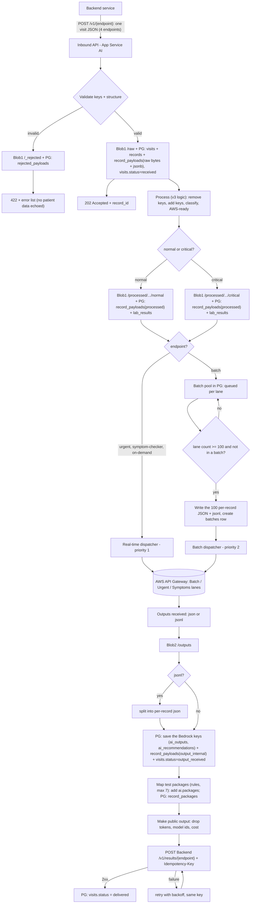
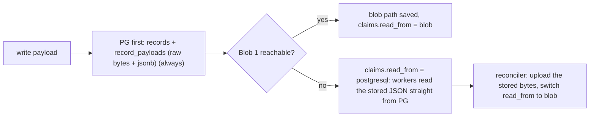
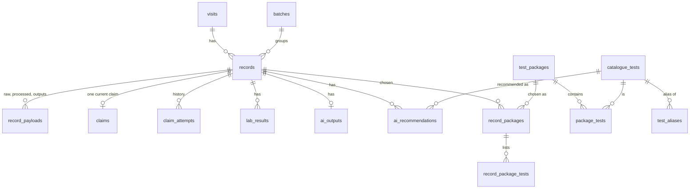
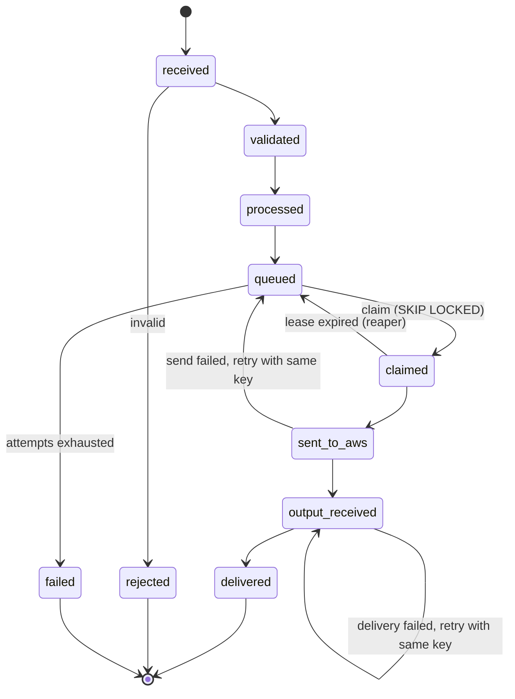
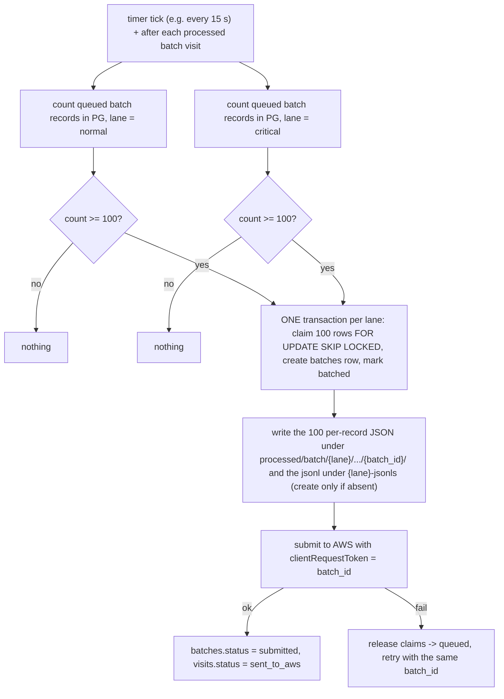

# Patient-360-pilot

AI Service - that turns a patient's LIMS lab results into a plain-language report: bilingual (EN/AR), with rules-based critical alerts and AI-generated explanations + AI Test recommendations.

> **Status: DESIGN (nothing implemented yet).** Written 2026-10-17, revised the same day, for the AI Solutions owner and the engineers who will build the service.
> Payload examples live in `prod/files/flow/` (called "the flow files" below). Pilot architecture: `prod/files/Patient-360.drawio.html`, "Pilot Version".
> Facts marked **verified** were read in official documentation on 2026-10-17; **UNVERIFIED** means the page did not confirm it.

---

## 1. Understanding (what was said, what is assumed)

**Said by the owner**

- The AI App Service **receives JSON from the Backend through 4 endpoints** (`on-demand`, `urgent`, `batch`, `symptom-checker`) and **sends JSON back through 4 endpoints**. The Backend sends **one JSON per visit** (never JSONL).
- Validate every payload (keys + structure). Valid -> Azure Blob 1 `/raw`; invalid -> `/_rejected`.
- **Processing = the same logic as v3**: remove keys (ids, company name, nulls, anything the model does not need), add keys (`status`, `alert`, `critical.direction`, mapped `lab_flag`, whole-number rule, `previous_*`, later the RAG `catalogue`), classify the patient normal / critical (tier -> lane), and make it AWS-ready. Result -> Blob 1 `/processed/.../normal|critical`.
- Priority: urgent, symptom-checker, on-demand first; batch second.
- **Batch files are built by us, not received**: a trigger counts processed batch visits per lane; when a lane reaches 100 not-yet-batched patients it writes a new JSONL of those 100 (AWS-ready) under `/processed/batch/{lane}-jsonls`.
- PostgreSQL stores every phase and is the **fallback when blobs are down**: the data is saved **both as structured columns and as the JSON exactly as it is**, so a failover reads the stored JSON and nothing has to be re-created. The JSON lives in its own normalised table (`record_payloads`), not in many columns on `records`. A tracing table says who claimed which record and where it is read from. Retries reuse the **same idempotency key**.
- Outputs: received from AWS -> saved in Blob 2 -> **the new keys from Bedrock are also saved in Postgres** and the **visit status is updated** at every phase. A batch output JSONL is split into per-record JSON. Before sending to the Backend, token counts and model ids are removed.
- **Test packages (new)**: after the AWS output is received, a pure function maps the AI-recommended tests to **test packages** (the selection rules, for example a cap such as 7, will be provided by the owner) (package data lives in Postgres, imported from `Test-Packages.xlsx`: name, tests in each package, classification, more columns later). The result is added to the JSON as `ai.packages` and sent to the Backend.
- Logging with `structlog` (safe under concurrency). Python 3.15, SOLID, smallest sufficient implementation.
- Pilot size: about **100,000 visits** (urgent, on-demand, batch), plus the **symptom-checker** when it opens. Open budget: choose what is suitable, not the minimum.

**Assumed (please correct)** - open questions are in section 15.

- The Pilot has no Azure Functions / Event Grid / Service Bus (those are in the Production half of the diagram). One App Service plan runs the API **and** the background workers.
- "Send through 4 endpoints" means **push**: the AI service calls 4 Backend endpoints with the final result; the inbound call only gets an acknowledgement (202).
- `on-demand` uses the same real-time AWS lane as `urgent` (the diagram only has Batch / Urgent / Symptoms lanes).

## 2. Scope and what we deliberately do NOT build (ponytail)

| In                                                                                                                                                                       | Out (until asked)                                             |
| ------------------------------------------------------------------------------------------------------------------------------------------------------------------------ | ------------------------------------------------------------- |
| 4 inbound + 4 outbound endpoints, validation, Blob + Postgres storage, claim/retry, batch trigger, output processing                                                     | Azure Functions, Event Grid, Service Bus (Production version) |
| Port of the v3 rules (status, alert, critical direction, tier -> lane)                                                                                                   | A rules engine or admin UI                                    |
| **Validation: Pydantic v2 is the proposed default; other options stay open** (msgspec, jsonschema - see D3). `json-repair` only as an optional, flagged pre-step | A generic "fix any JSON" layer                                |
| One Postgres claim table, `FOR UPDATE SKIP LOCKED`                                                                                                                     | An external queue (Kafka, RabbitMQ)                           |
| `structlog` JSON logging with a PII allow-list                                                                                                                         | A log-search product                                          |
| Retry with backoff + a `failed` status you can see                                                                                                                     | Automatic replay UI                                           |

## 3. Architecture at a glance



**Blob down -> Postgres fallback (no re-creation needed)**



## 4. Decisions (approaches considered)

| #  | Question                      | Chosen                                                                                                                                                                                                                                              | Why / trade-off                                                                                                                                                                                                                                      |
| -- | ----------------------------- | --------------------------------------------------------------------------------------------------------------------------------------------------------------------------------------------------------------------------------------------------- | ---------------------------------------------------------------------------------------------------------------------------------------------------------------------------------------------------------------------------------------------------- |
| D1 | Who moves data between steps  | **In-process workers inside the AI App Service** (Pilot)                                                                                                                                                                                      | Matches the Pilot diagram; one image, two apps (api + worker). Production can swap to Functions + Event Grid because workers only depend on ports (section 6).                                                                                       |
| D2 | How results reach the Backend | **Push to 4 Backend endpoints**, inbound returns 202                                                                                                                                                                                          | Real-time Bedrock calls can exceed API Gateway's default 29 s integration timeout (verified).                                                                                                                                                        |
| D3 | Validation                    | **Default: Pydantic v2** (strict, `extra="forbid"`, discriminated on `source`). **Open alternatives:** `msgspec` (fastest, only the first error is reported), `jsonschema` (one contract file shared with the Backend, slowest) | Pydantic reports every error at once (verified). The validator sits behind a `Validator` port, so swapping is one adapter. `json-repair` is a lenient fixer, not a validator, and may silently alter values - section 11.                        |
| D4 | Exactly-once sending          | **Postgres claim table**, `INSERT ... ON CONFLICT DO NOTHING`, `FOR UPDATE SKIP LOCKED`                                                                                                                                                   | Bedrock `InvokeModel` has no idempotency token (verified), so dedupe must be ours.                                                                                                                                                                 |
| D5 | Record ids                    | `record_id = HMAC-SHA256(key from Key Vault, patient_id\|visit_id\|endpoint\|source_hash)`; `source_hash` = SHA-256 of the canonical JSON; symptom checker uses a random UUID `request_id` | Same data re-sent = same id = duplicate (primary key stops it). **Changed data = a new id = a new record**, so it is never dropped. Plain SHA-256 of short numeric ids can be guessed, so HMAC. Names and tags carry no patient or visit id. The id is also the Backend `Idempotency-Key`. |
| D6 | Batch size                    | **100 per lane per file**                                                                                                                                                                                                                     | Verified: Bedrock minimum is 100 records per job for the Claude models listed.                                                                                                                                                                       |
| D7 | Postgres data model           | **Normalised**: a narrow `records` header with real foreign keys, the JSON in **`record_payloads`** (one insert-only row per `kind` and `version`: `raw`, `processed`, `output_internal`, `output_public`), structured `lab_results` / `ai_*` tables for analysis | `jsonb` does not preserve whitespace, key order or duplicate keys (verified), so the raw copy also keeps `bytea`. Big JSON off the hot rows keeps updates cheap; one `SELECT` still returns a ready-to-send document for failover. See 5.2. |
| D8 | Logging                       | **`structlog`** + contextvars, JSON output, PII **allow-list**                                                                                                                                                                        | Context (`record_id`, `endpoint`, `stage`) follows each asyncio task; section 6.3.                                                                                                                                                             |
| D10 | Test packages                | **Reference tables in Postgres** (`test_packages`, `package_tests`, `catalogue_tests`, `test_aliases`) + a **pure** selection function (rule to be provided by the owner); result stored in `record_packages` and added to the JSON as `ai.packages` | Rules change without touching storage; the output of a record is reproducible from its recommendations and the package version. The selection rule is not defined yet (5.3). |
| D9 | Hosting size for 100K         | **See section 12**                                                                                                                                                                                                                            | Compute is not the bottleneck; zone redundancy, private networking and headroom are.                                                                                                                                                                 |

## 5. Storage

### 5.1 Azure Blob 1 (`ai-input`) and Blob 2 (`ai-output`)

Folders are virtual name prefixes unless hierarchical namespace is enabled (verified).

```
Azure Blob 1 Folder Structure (Json Files)
/raw
--/on-demand        files: {yyyy}/{MM}/{dd}/{recordId}.json
--/urgent          files: {yyyy}/{MM}/{dd}/{recordId}.json
--/batch           files: {yyyy}/{MM}/{dd}/{recordId}.json        (one visit per file, as received)
--/symptom-checker files: {yyyy}/{MM}/{dd}/{request_id}.json
--/_rejected       files: {source}/{yyyy}/{MM}/{dd}/{id}.json     (+ {id}.errors.json beside it)

/processed
--/on-demand
----/normal        files: {yyyy}/{MM}/{dd}/{recordId}.json
----/critical      files: {yyyy}/{MM}/{dd}/{recordId}.json
--/urgent
----/normal        files: {yyyy}/{MM}/{dd}/{recordId}.json
----/critical      files: {yyyy}/{MM}/{dd}/{recordId}.json
--/batch                                                          (written ONLY when the 100-patient trigger fires)
----/normal         files: {yyyy}/{MM}/{dd}/{batch_id}/{recordId}.json
----/normal-jsonls  files: {yyyy}/{MM}/{dd}/{batch_id}.jsonl      (the 100 records, created by us)
----/critical        files: {yyyy}/{MM}/{dd}/{batch_id}/{recordId}.json
----/critical-jsonls files: {yyyy}/{MM}/{dd}/{batch_id}.jsonl
--/symptom-checker
----/normal        files: {yyyy}/{MM}/{dd}/{request_id}.json
----/critical      files: {yyyy}/{MM}/{dd}/{request_id}.json

Azure Blob 2 Folder Structure (Json Files)
outputs/
--/on-demand
----/normal        files: {yyyy}/{MM}/{dd}/{recordId}.json
----/critical      files: {yyyy}/{MM}/{dd}/{recordId}.json
--/urgent
----/normal        files: {yyyy}/{MM}/{dd}/{recordId}.json
----/critical      files: {yyyy}/{MM}/{dd}/{recordId}.json
--/batch
----/normal         files: {yyyy}/{MM}/{dd}/{batch_id}/{recordId}.json
----/normal-jsonls  files: {yyyy}/{MM}/{dd}/{batch_id}/output.jsonl + errors.jsonl
----/critical        files: {yyyy}/{MM}/{dd}/{batch_id}/{recordId}.json
----/critical-jsonls files: {yyyy}/{MM}/{dd}/{batch_id}/output.jsonl + errors.jsonl
----/_manifests     files: {yyyy}/{MM}/{dd}/{batch_id}.json
--/symptom-checker
----/normal        files: {yyyy}/{MM}/{dd}/{request_id}.json
----/critical      files: {yyyy}/{MM}/{dd}/{request_id}.json
/_aws-raw           (only if AWS pushes raw model output here)
```

**Rules**

- Names are opaque: no patient or visit id in a blob name, metadata or tag (Event Grid `BlobCreated` puts the blob path in `subject` - verified).
- **Batch**: until a batch exists, a processed batch visit lives **only in Postgres** (`record_payloads` kind `processed`, `claims.status='pending'`). When the trigger fires it writes the 100 per-record JSON under `{batch_id}/` **and** the JSONL, so the folder tree above stays exactly as designed and nothing has to be moved or renamed.
- Create with "only if absent" (`overwrite=False` / `If-None-Match: *`); a "already exists" error means "already stored", not a failure.
- `raw` is never edited. `processed` holds the AI document **before RAG** (flow `2a`), because the Pilot diagram runs "S3 + Retrieval" inside the AWS lane. If the AI service calls the Knowledge Base itself, it holds `2b`.
- A `...-jsonls` line is `{ "recordId": "...", "document": { ...2a... } }`.
- `outputs` hold the **internal** result (with model id and usage, for cost analysis). The Backend only ever receives the public view (`to_public`, section 8.3).
- Lane: `normal` = Haiku lane (tiers NORMAL + MILD), `critical` = Sonnet lane (MODERATE + CRITICAL). For `symptom-checker` the lane is the tier of the visit it belongs to (from Postgres).

### 5.2 PostgreSQL: normalised, JSON kept as-is in its own table

**Answer to "can we normalise and put the JSON in a table?": yes, and it is the better design.** The earlier draft put `raw_bytes`, `raw_json`, `processed_doc`, `output_internal`, `output_public` as columns of `records`. Review found that (a) large JSON on a row that is updated at every stage makes every update heavier (Postgres rewrites the whole row version; large values are stored out of line, TOAST), (b) nothing could say which version of a payload was sent, (c) the draft had a circular foreign key (`records` <-> `visits.last_record_id`), a `text[]` of record ids that cannot be a foreign key, and rejected payloads that could not fit `records` because their ids may be missing. All three are fixed below. Full SQL: `migrations/001_init.sql` (the same text as this block).

| Table | Holds | Why separate |
| --- | --- | --- |
| `visits` | business progress per visit (status, tier, lane) | updated at every phase |
| `records` | one narrow header per accepted payload, FK to `visits` and `batches` | small hot row, `fillfactor=70` so updates stay in-page |
| `record_payloads` | the JSON per `kind` and `version`: `body jsonb` + `raw_bytes bytea` (raw only) + `sha256`; insert-only | one row per artefact, history kept, no rewriting of big values |
| `rejected_payloads` | invalid payloads, errors, blob path | may have no ids, so cannot live in `records` |
| `lab_results`, `ai_outputs`, `ai_recommendations` | the keys, structured | analysis without parsing JSON |
| `catalogue_tests`, `test_aliases`, `test_packages`, `package_tests` | package reference data | see 5.3 |
| `record_packages`, `record_package_tests` | packages chosen per record | audit and reporting |
| `claims` | exactly one current claim per record (tracing table) | updated often |
| `claim_attempts` | insert-only history of every attempt | audit; keeps `claims` current-state only |
| `batches` | one row per batch; members are `records.batch_id` | a real FK instead of an array |



```sql
-- Patient-360 pilot: initial schema (PostgreSQL 16+). One transaction, no circular foreign keys.
BEGIN;

-- ===== business progress per visit ================================================================
CREATE TABLE visits (
  visit_id    bigint PRIMARY KEY,
  patient_id  bigint NOT NULL,
  status      text NOT NULL DEFAULT 'received'
              CHECK (status IN ('received','processing','sent_to_aws','output_received','delivered','failed')),
  tier        text CHECK (tier IN ('NORMAL','MILD','MODERATE','CRITICAL')),
  lane        text CHECK (lane IN ('normal','critical')),
  created_at  timestamptz NOT NULL DEFAULT now(),
  updated_at  timestamptz NOT NULL DEFAULT now()
) WITH (fillfactor = 70, autovacuum_vacuum_scale_factor = 0.02);

CREATE TABLE batches (
  batch_id    text PRIMARY KEY,
  lane        text NOT NULL CHECK (lane IN ('normal','critical')),
  aws_job_id  text,
  status      text NOT NULL DEFAULT 'created'
              CHECK (status IN ('created','submitted','completed','partially_completed','failed')),
  created_at  timestamptz NOT NULL DEFAULT now()
);

-- ===== one row per accepted payload: narrow header only (the JSON lives in record_payloads) ========
CREATE TABLE records (
  record_id    text PRIMARY KEY,                       -- HMAC(patient|visit|endpoint|source_hash); UUID for symptom checks
  visit_id     bigint NOT NULL REFERENCES visits (visit_id),
  endpoint     text NOT NULL CHECK (endpoint IN ('on-demand','urgent','batch','symptom-checker')),
  company_name text,
  age_years    int,
  sex          text CHECK (sex IN ('male','female')),
  lane         text CHECK (lane IN ('normal','critical')),
  tier         text CHECK (tier IN ('NORMAL','MILD','MODERATE','CRITICAL')),
  source_hash  text NOT NULL,                          -- part of record_id: changed data = new record
  batch_id     text REFERENCES batches (batch_id),
  stage        text NOT NULL DEFAULT 'received'
               CHECK (stage IN ('received','validated','processed','queued','sent_to_aws',
                                'output_received','delivered','failed')),
  created_at   timestamptz NOT NULL DEFAULT now(),
  updated_at   timestamptz NOT NULL DEFAULT now()
) WITH (fillfactor = 70, autovacuum_vacuum_scale_factor = 0.02);
CREATE INDEX records_visit_latest ON records (visit_id, created_at DESC);   -- "latest record of a visit"
CREATE INDEX records_batch ON records (batch_id) WHERE batch_id IS NOT NULL;

-- ===== the JSON itself, insert-only and versioned (normalised: one row per kind and version) ======
CREATE TABLE record_payloads (
  record_id  text NOT NULL REFERENCES records (record_id),
  kind       text NOT NULL CHECK (kind IN ('raw','processed','output_internal','output_public')),
  version    int  NOT NULL DEFAULT 1,
  body       jsonb NOT NULL CHECK (jsonb_typeof(body) = 'object'),   -- queryable, NOT byte-exact
  raw_bytes  bytea,                                                  -- exactly what the Backend sent
  sha256     text NOT NULL,
  created_at timestamptz NOT NULL DEFAULT now(),
  PRIMARY KEY (record_id, kind, version),
  CHECK ((kind = 'raw') = (raw_bytes IS NOT NULL))
);
CREATE VIEW record_payloads_current AS
  SELECT DISTINCT ON (record_id, kind) *
  FROM record_payloads ORDER BY record_id, kind, version DESC;

-- payloads that failed validation: they may lack ids, so they never go into records
CREATE TABLE rejected_payloads (
  rejected_id bigint GENERATED ALWAYS AS IDENTITY PRIMARY KEY,
  endpoint    text NOT NULL,
  raw_bytes   bytea NOT NULL,
  errors      jsonb NOT NULL,
  blob_path   text,
  received_at timestamptz NOT NULL DEFAULT now()
);

-- ===== reference data: catalogue and test packages =================================================
CREATE TABLE catalogue_tests (
  test_id     int PRIMARY KEY,
  name        text NOT NULL,
  name_norm   text NOT NULL UNIQUE,                    -- lower-case, single spaces
  description text
);
CREATE TABLE test_aliases (
  alias_norm text PRIMARY KEY,
  test_id    int NOT NULL REFERENCES catalogue_tests (test_id)
);
CREATE TABLE test_packages (
  package_id     int PRIMARY KEY,                      -- the workbook "Profile ID"
  name           text NOT NULL UNIQUE,
  classification text,                                 -- empty in the workbook today; meaning to be confirmed
  active         boolean NOT NULL DEFAULT true
);
CREATE TABLE package_tests (
  package_id       int  NOT NULL REFERENCES test_packages (package_id),
  source_test_id   int  NOT NULL,
  source_test_name text NOT NULL,
  test_id          int  REFERENCES catalogue_tests (test_id),   -- NULL until aliased to the catalogue
  PRIMARY KEY (package_id, source_test_id)
);
CREATE INDEX package_tests_test ON package_tests (test_id) WHERE test_id IS NOT NULL;

-- ===== structured copies of the keys (analysis without parsing JSON) ================================
CREATE TABLE lab_results (
  lab_result_id      bigint GENERATED ALWAYS AS IDENTITY PRIMARY KEY,   -- a repeated parameter is allowed
  record_id          text NOT NULL REFERENCES records (record_id),
  test_name          text NOT NULL,
  parameter_name     text NOT NULL,
  result_date        date,
  value_text         text,
  value_num          numeric,
  unit               text,
  ref_low            numeric,
  ref_high           numeric,
  ref_range          text,
  status             text CHECK (status IN ('high','low','normal','abnormal')),
  lab_flag           text CHECK (lab_flag IN ('High','Low')),
  alert              text CHECK (alert IN ('NORMAL','MEDICAL_ATTENTION','CRITICAL','NOT_CLASSIFIED')),
  critical_low       numeric,
  critical_high      numeric,
  critical_direction text CHECK (critical_direction IN ('critical_low','critical_high')),
  previous_value     text,
  previous_date      date,
  parameter_remark   text
);
CREATE INDEX lab_results_record ON lab_results (record_id);

CREATE TABLE ai_outputs (
  record_id            text PRIMARY KEY REFERENCES records (record_id),
  status               text NOT NULL CHECK (status IN ('success','guardrail_blocked','error','answered')),
  highest_alert        text,
  summary_en           text, summary_ar text,
  simple_summary_en    text, simple_summary_ar text,
  note_en              text, note_ar text,
  critical_alerts      jsonb,
  advisory_level       text,
  guardrail_action     text CHECK (guardrail_action IN ('NONE','INTERVENED')),
  model_id             text,                           -- INTERNAL ONLY
  translation_model_id text,                           -- INTERNAL ONLY
  input_tokens         int, output_tokens int,         -- INTERNAL ONLY
  cost_usd             numeric(10,5),                  -- INTERNAL ONLY
  generated_at         timestamptz
);
CREATE TABLE ai_recommendations (
  record_id         text NOT NULL REFERENCES records (record_id),
  catalogue_test_id int  NOT NULL REFERENCES catalogue_tests (test_id),
  priority          text NOT NULL CHECK (priority IN ('urgent','important')),
  reason_en text, reason_ar text, timing_en text, timing_ar text, guideline_en text, guideline_ar text,
  PRIMARY KEY (record_id, catalogue_test_id)
);

-- test packages chosen for a record (rules in the application, results here)
CREATE TABLE record_packages (
  record_id  text NOT NULL REFERENCES records (record_id),
  package_id int  NOT NULL REFERENCES test_packages (package_id),
  rank       int  NOT NULL CHECK (rank >= 1),            -- the cap (if any) lives in the selection rule
  score      numeric(6,4),                              -- only if the owner's rule produces one
  PRIMARY KEY (record_id, package_id)
);
CREATE TABLE record_package_tests (
  record_id  text NOT NULL,
  package_id int  NOT NULL,
  test_id    int  NOT NULL REFERENCES catalogue_tests (test_id),
  PRIMARY KEY (record_id, package_id, test_id),
  FOREIGN KEY (record_id, package_id) REFERENCES record_packages (record_id, package_id)
);

-- ===== execution state: who is working on which record, and retries ================================
CREATE TABLE claims (                                   -- exactly ONE current claim per record
  record_id       text PRIMARY KEY REFERENCES records (record_id),
  read_from       text NOT NULL CHECK (read_from IN ('blob','postgresql')),
  status          text NOT NULL DEFAULT 'pending'
                  CHECK (status IN ('pending','processing','sent','delivered','failed')),
  claimed_by      text,                                 -- e.g. 'normal-batch-endpoint', 'urgent'
  idempotency_key text NOT NULL,
  attempts        int  NOT NULL DEFAULT 0,
  next_retry_at   timestamptz,
  last_error      text,
  updated_at      timestamptz NOT NULL DEFAULT now()
) WITH (fillfactor = 70, autovacuum_vacuum_scale_factor = 0.02);
CREATE INDEX claims_pending ON claims (updated_at) WHERE status = 'pending';

CREATE TABLE claim_attempts (                           -- insert-only audit trail of every attempt
  claim_attempt_id bigint GENERATED ALWAYS AS IDENTITY PRIMARY KEY,
  record_id        text NOT NULL REFERENCES records (record_id),
  attempt          int  NOT NULL,
  started_at       timestamptz NOT NULL DEFAULT now(),
  finished_at      timestamptz,
  outcome          text CHECK (outcome IN ('sent','retry','failed')),
  error            text
);
CREATE INDEX claim_attempts_record ON claim_attempts (record_id);

-- the tracing view the owner described: visit | source | status | claimed-by
CREATE VIEW claim_trace AS
  SELECT r.visit_id, c.read_from AS source, c.status, c.claimed_by
  FROM claims c JOIN records r USING (record_id);

COMMIT;
```

**Best practice applied** (sources in section 16; items marked "from memory" were not re-read):

- Foreign keys declared on every relation; Postgres does **not** index the referencing column automatically, so the ones that are joined (`records.visit_id`, `records.batch_id`, `package_tests.test_id`) have an index.
- `jsonb` for the queryable body, `bytea` for the byte-exact raw copy (`jsonb` drops whitespace, key order and duplicate keys). `CHECK (jsonb_typeof(body) = 'object')`. No GIN index until a real query needs it.
- Payloads are **insert-only and versioned**; current version = view `record_payloads_current`. Hot state lives in `visits`, `records`, `claims` with lower `fillfactor` (HOT updates) and a lower autovacuum scale factor.
- Duplicate protection is the **primary key** `record_id` (it contains `source_hash`, so changed data is a new record, never a collision); claims use a **partial index** `WHERE status='pending'` and `FOR UPDATE SKIP LOCKED` (section 8.4).
- No `extra jsonb` catch-all column; new fields are added by a migration so the schema stays honest.
- Connections through the built-in PgBouncer (port 6432, transaction mode): no session state, no advisory locks held across statements.
- Not run: nothing here has been executed against PostgreSQL yet (the test in the plan only checks the file text). Running `001_init.sql` on an empty database is Task 8, step 4b of the plan.

Example of the tracing table (the view `claim_trace`):

| visit_id | source     | status     | claimed_by            |
| -------- | ---------- | ---------- | --------------------- |
| 299292   | blob       | processing | normal-batch-endpoint |
| 293473   | postgresql | sent       | urgent                |

### 5.3 Test packages (new): data, mapping function, output

**Data.** Imported once from `prod/files/Test-Packages.xlsx` by an idempotent importer (not built yet; its pure first step, `forward_fill_packages`, is in the plan). The workbook has the package id and name only on the first row of each package, so the importer forward-fills them, collapses repeated spaces in names, and keeps packages that have no tests. Test names in the workbook do not all match the catalogue (about 80 of them in the sheet that was read), so a `test_aliases` table maps normalised names to `catalogue_tests`; `package_tests.test_id` stays `NULL` until a name is aliased, and unmatched tests simply never match.

**Selection rule: NOT DEFINED YET.** The owner will provide the rules (which packages, how many, in what order, whether a score is used). Until then the code has only the data types, the workbook import step and the output key. When the rule exists it is added as one pure function in `domain/packages.py`:

```python
select_packages(recommended_test_ids: set[int], packages: list[Package]) -> list[PackageMatch]   # rule: to be provided
attach_packages(output: dict, matches: list[PackageMatch], test_names: dict[int, str]) -> dict   # built: adds ai.packages, no mutation
```

**Output.** `ai.packages` is a list: `{rank, package_id, name, classification (only if set), matched_tests[], score (only if the rule gives one)}`. It is added **before** `to_public`, so it is in both the internal and the public output, and it is stored in `record_packages` / `record_package_tests`.

## 6. Project layout (SOLID, ports and adapters)

### 6.1 Layout

```
src/patient360/
  api/        inbound.py              4 inbound routes (thin: parse -> service -> 202)
  domain/     models.py               Pydantic payload models (strict)
              logic.py                status, alert, critical direction, whole-number rule, prune   (pure)
              classify.py             tier + lane                                                   (pure)
              document.py             build AI document, symptom document, AWS-ready lines          (pure)
              public.py               internal output -> public output                              (pure)
              packages.py             
              flatten.py              processed doc -> lab_results rows; AI output -> ai_* rows     (pure)
  services/   ingest.py  process.py  dispatch.py  batch_trigger.py  outputs.py  deliver.py  retry.py  visit_status.py  package_mapping.py
  ports.py                            Protocols only (incl. PackageRepository: active packages, save record packages)
  adapters/   blob_store.py  pg_repo.py  fallback_store.py  aws_gateway.py  backend_client.py  repair.py  package_importer.py
  observability/ logging.py           structlog setup + PII allow-list
  ids.py  config.py  bootstrap.py     bootstrap = the only place that wires concrete classes
tests/        domain/ (no I/O)  services/ (fake adapters)  contract/ (flow files)
```

### 6.2 SOLID

| SOLID       | How it shows up here                                                                                                                                                                                                                               |
| ----------- | -------------------------------------------------------------------------------------------------------------------------------------------------------------------------------------------------------------------------------------------------- |
| **S** | One reason to change per class: `Validator` (shape), `ClassifierService` (tier/lane), `DocumentBuilder` (keys), `BatchTrigger` (counting), `Deliverer` (push to Backend), `ClaimRepository` (leases), `VisitStatusService` (status). |
| **O** | Each endpoint is an `EndpointHandler` in a registry; adding a fifth source = one new class and one registry line. Lanes and routes are tables (`frozendict`), not `if` chains.                                                               |
| **L** | `FallbackPayloadStore` (Postgres + blob) and `BlobPayloadStore` are interchangeable behind `PayloadStore`; test fakes behave the same.                                                                                                       |
| **I** | Small Protocols: `PayloadStore`, `RecordRepository`, `ClaimRepository`, `AwsGateway`, `BackendClient`, `Validator`, `Clock`, `IdFactory` - a service imports only what it uses.                                                    |
| **D** | Services depend on `ports.py`; adapters implement them; `bootstrap.py` wires. No service imports `boto3`, `azure`, or `psycopg`.                                                                                                         |

```python
# ports.py (signatures only)
class Validator(Protocol):
    def validate(self, raw: bytes, endpoint: str) -> Valid | Invalid: ...
class PayloadStore(Protocol):                                           # blob side only
    async def put(self, area: str, path: str, data: bytes, *, overwrite: bool = False) -> PutResult: ...
    async def get(self, area: str, path: str) -> bytes: ...
class RecordRepository(Protocol):                                       # PG side: JSON as-is + structured rows
    async def save_raw(self, rec: NewRecord) -> SaveResult: ...         # idempotent on the unique key; writes raw_bytes + raw_json
    async def save_processed(self, record_id: str, doc: dict, rows: list[LabRow], tier: str, lane: str) -> None: ...
    async def save_ai_output(self, record_id: str, internal: dict, public: dict, rows: AiRows) -> None: ...
    async def get_json(self, record_id: str, kind: str) -> bytes | dict: ...   # kind: raw|processed|output_public -> the fallback read
    async def set_visit_status(self, visit_id: int, status: str, record_id: str) -> None: ...
class ClaimRepository(Protocol):
    async def enqueue(self, record_id: str, visit_id: int, read_from: str, claimed_by: str) -> None: ...
    async def claim(self, lane: str, endpoint: str, limit: int, worker: str) -> list[Claim]: ...   # SKIP LOCKED
    async def mark(self, record_id: str, status: str, *, error: str | None = None) -> None: ...
    async def reap_stale(self, older_than_s: int, max_attempts: int) -> int: ...
class AwsGateway(Protocol):
    async def send_realtime(self, lane: str, req: AwsRequest) -> AwsAck | AwsResult: ...
    async def submit_batch(self, lane: str, batch_id: str, jsonl: bytes) -> AwsJob: ...
class BackendClient(Protocol):
    async def post_result(self, endpoint: str, body: dict, idempotency_key: str) -> DeliveryResult: ...
```

### 6.3 Logging with structlog (checked against structlog.org)

- `structlog` 26.1.0, Python >= 3.10; the PyPI classifiers list 3.14 and 3.15 (verified).
- **Concurrency**: `structlog.contextvars` - `merge_contextvars` as the **first** processor, `bind_contextvars(record_id=..., endpoint=..., stage=...)`, `clear_contextvars()` at the start of every request and every worker task, `bound_contextvars()` as a context manager. Per the docs the storage is separate per concurrency model (threads, event loop); in hybrid sync/async code (FastAPI/Starlette) a value bound in sync code may not appear in async code - bind inside the async handler. Async methods exist (`await log.ainfo(...)`).
- **Config**: `merge_contextvars`, `add_log_level`, `TimeStamper(fmt="iso", utc=True)`, `pii_guard`, `dict_tracebacks`, `JSONRenderer`; `make_filtering_bound_logger(level)`; `cache_logger_on_first_use=True` (configure once at startup - a later `configure()` does not affect cached loggers). Exact names of `dict_tracebacks` / `TimeStamper` options are from memory: UNVERIFIED.
- **PII rule**: log only `record_id`, `endpoint`, `stage`, `attempt`, `duration_ms`, `status`. Use an **allow-list processor** (drops every other key), not a block-list: a block-list misses nested data and values inside message strings, and exception text can carry values.
- **Standard library bridge**: `structlog.stdlib.ProcessorFormatter` with `foreign_pre_chain=shared` so uvicorn, boto3 and azure-sdk records are JSON too and pass through the same PII guard (documented example; uvicorn handler setup UNVERIFIED).
- **Azure Monitor**: the Learn page (updated 2026-10-09) recommends the new `microsoft-opentelemetry` package (`use_microsoft_opentelemetry(enable_azure_monitor=True, logger_name=...)`); the older `azure-monitor-opentelemetry` 1.8.11 (`configure_azure_monitor`) is still current. Never initialise both. Neither lists a Python 3.15 classifier. Trace-id correlation with structlog is UNVERIFIED (needs a small processor that adds the current span's trace id).

## 7. API contracts

### 7.1 Inbound: Backend -> AI service (4 endpoints, one visit JSON per call)

| Endpoint                     | Body (example file)                                                                                     | 202 body                                             | Other responses                      |
| ---------------------------- | ------------------------------------------------------------------------------------------------------- | ---------------------------------------------------- | ------------------------------------ |
| `POST /v1/urgent`          | normal payload, `source:"urgent"` (`flow/03-urgent/1-backend-input.json`)                           | `{"status":"accepted","record_id":"..."}`          | 422 invalid, 200 `duplicate`       |
| `POST /v1/symptom-checker` | 4 keys (`flow/05-symptom-checker/1-backend-input.json`)                                               | `{"status":"accepted","record_id":"<request_id>"}` | 422 invalid, 404 `VISIT_NOT_FOUND` |
| `POST /v1/on-demand`       | normal payload (`flow/04-on-demand/1-backend-input.json`)                                             | same as urgent                                       | same                                 |
| `POST /v1/batch`           | **one visit JSON per call**, `source:"batch"` (`flow/02-batch-critical/1-backend-input.json`) | `{"status":"accepted","record_id":"..."}`          | 422 invalid, 200 `duplicate`       |

- **Acknowledge only after a durable save** (Postgres always; blob when reachable).
- 422 body: `{"status":"rejected","errors":[{"loc":[...],"msg":"...","type":"..."}]}`; never echo the input (patient data).
- `source` in the body must equal the endpoint (`/v1/urgent` + `source:"batch"` -> 422).
- The JSONL for AWS is built by **our** trigger (section 8.2), not uploaded by the Backend. Accepting an array of visits per call can be added later (O16).
- Auth: the shared service-to-service mechanism (Key Vault secret or managed identity) - to be fixed with the Backend team.

### 7.2 Outbound: AI service -> Backend (4 endpoints)

| Endpoint (Backend)                   | Body                                                                             | Header                            |
| ------------------------------------ | -------------------------------------------------------------------------------- | --------------------------------- |
| `POST /v1/results/urgent`          | public output (flow `5-ai-service-output.json`)                                | `Idempotency-Key: <record_id>`  |
| `POST /v1/results/symptom-checker` | public output incl. `guardrail_blocked` / `error` statuses (`05b`, `5b`) | `Idempotency-Key: <request_id>` |
| `POST /v1/results/on-demand`       | public output                                                                    | same                              |
| `POST /v1/results/batch`           | one public output per call (the JSONL is split first)                            | `Idempotency-Key: <record_id>`  |

- 2xx **or** 409 "already received" = delivered. 429/5xx/timeout = retry. Other 4xx = `failed` + alert.
- **Public output** = internal output **minus** `meta.model_id`, `meta.translation_model_id`, `meta.usage` (tokens, cost). Whether `tier` / `meta.mode` stay is decision O8. The public output **keeps** `ai.packages` (rank, id, name, classification, matched tests, optional score).

### 7.3 AI service <-> AWS

- AI -> AWS: API Gateway, three lanes (Batch, Urgent, Symptoms). Payloads: `flow/*/3-bedrock-*.json`. Batch job: `clientRequestToken` derived from `batch_id` (verified: a repeated token = request ignored, no error).
- AWS -> AI: batch via SNS (then pull from S3) or direct S3 -> Blob 2 copy; real-time as the HTTP response, or poll if the call exceeds the API Gateway timeout. Output lines are matched by `recordId` (Bedrock does not guarantee order - verified).

### 7.4 Priorities

Separate worker pools with reserved concurrency: `urgent` > `symptom-checker` > `on-demand` > `batch`. Batch only takes the capacity left over; it never blocks real-time.

## 8. Pipelines

### 8.1 Retry and claim states



### 8.2 Batch trigger (we build the JSONL)



### 8.3 Pseudocode (inputs -> outputs)

```python
# ---- ids --------------------------------------------------------------------------
def make_record_id(key: bytes, *, patient_id: int, visit_id: int, endpoint: str, source_hash: str) -> str:
    return hmac_sha256(key, f"{patient_id}|{visit_id}|{endpoint}|{source_hash}").hexdigest()[:32]   # opaque, deterministic
def make_request_id() -> str: return uuid4().hex                                    # symptom checks

# ---- 1. validate (trust boundary) -------------------------------------------------
def validate_payload(raw: bytes, endpoint: str, *, allow_repair: bool) -> Valid | Invalid:   # behind the Validator port
    try:    obj = json.loads(raw)                                                    # strict first
    except JSONDecodeError as e:
        if not allow_repair: return Invalid(errors=[syntax_error(e)])
        obj = repair_json(raw, strict=True, return_objects=True)                   # optional, OFF by default
    model = MODELS[endpoint]                                                         # frozendict: endpoint -> Pydantic model
    try:    payload = model.model_validate(obj, strict=True)                         # extra="forbid"
    except ValidationError as e:
        return Invalid(errors=e.errors(include_url=False, include_input=False))
    if payload.source != endpoint: return Invalid(errors=[source_mismatch()])
    return Valid(payload)                                                            # original bytes are kept untouched

# ---- 2. accept: PG first, then blob ----------------------------------------------
async def accept(raw: bytes, endpoint: str) -> Ack:
    log = bind(endpoint=endpoint)                                                    # structlog contextvars; never PII
    result = validate_payload(raw, endpoint, allow_repair=cfg.allow_repair)
    rid = make_request_id() if endpoint == "symptom-checker" else make_record_id(...)
    if isinstance(result, Invalid):
        await safe_put(f"_rejected/{endpoint}/{ymd()}/{rid}.json", raw, rid)
        await safe_put(f"_rejected/{endpoint}/{ymd()}/{rid}.errors.json", dumps(result.errors), rid)
        await repo.save_rejected(rid, endpoint, raw, result.errors)                 # rejected_payloads row (needs no ids)
        return Ack.rejected(result.errors)                                          # -> 422
    p = result.payload
    saved = await repo.save_raw(NewRecord(rid, endpoint, p, raw_bytes=raw, raw_json=p.model_dump(),
                                          source_hash=source_hash(p)))   # one transaction: upsert visits, insert records + record_payloads(raw)
    if saved.duplicate: return Ack.duplicate(saved.record_id)                       # -> 200
    await safe_put(f"raw/{endpoint}/{ymd()}/{rid}.json", raw, rid)                  # blob; failure -> read_from='postgresql'
    await claims.enqueue(rid, p.visit_id, read_from=read_from_of(rid), claimed_by=f"{endpoint}-endpoint")
    await visits.set(p.visit_id, "received", rid)
    return Ack.accepted(rid)                                                        # -> 202

async def safe_put(path, data, rid, *, area="input"):
    try:    await store.put(area, path, data, overwrite=False)                      # create only if absent
    except ResourceExistsError: pass                                                # already stored
    except BlobUnavailable: await repo.set_read_from(rid, "postgresql")            # PG already holds the exact bytes

async def load_json(rid: str, kind: str) -> dict:                                   # the FALLBACK READ: no re-creation
    try:    return loads(await store.get(*path_of(rid, kind)))
    except (BlobUnavailable, NotFound): return await repo.get_json(rid, kind)      # one SELECT on record_payloads_current

# ---- 3. process: v3 logic ---------------------------------------------------------
def apply_logic(p: Payload) -> LogicResult:                                         # PURE
    for r in results(p):
        low, high = reference_bounds(r)                                            # CONVLOW/HIGH -> NORMAL* -> parsed text
        status    = classify_result(r.value, low, high) or classify_words(r) or lab_flag_status(r.lab_flag)
        direction = critical_breach(r.value, r.critical, status, low, high)         # 'critical_low' | 'critical_high' | None
        alert     = "CRITICAL" if direction else MEDICAL_ATTENTION if status in ABNORMAL else NORMAL if status == "normal" else NOT_CLASSIFIED
        r.update(status=status, alert=alert, direction=direction,
                 lab_flag={"H":"High","L":"Low"}.get(r.lab_flag),
                 value=whole_or_text(r.value), previous_value=whole_or_text(r.previous_value))
    return LogicResult(doc=prune_none_and_empty(drop_keys(p)), flat=flat_rows(p))   # drops ids/company_name, removes nulls

def classify_patient(flat: list[Row]) -> Tier:                                      # PURE, ported from v3 severity.decideTier
    critical = any(f.is_critical for f in flat)
    unrangeable = any(f.value and f.status is None for f in flat)
    abnormal = sum(f.status in ABNORMAL and not f.is_critical for f in flat)
    return CRITICAL if critical else MODERATE if unrangeable or abnormal >= 3 else MILD if abnormal else NORMAL

LANE_BY_TIER = frozendict(NORMAL="normal", MILD="normal", MODERATE="critical", CRITICAL="critical")

async def process(record_id: str) -> None:
    rec = await repo.load(record_id)
    logic = apply_logic(rec.payload); tier = classify_patient(logic.flat); lane = LANE_BY_TIER[tier]
    doc = logic.doc                                                                  # flow "2a" (before RAG)
    await repo.save_processed(record_id, doc, flatten_lab_rows(doc), tier, lane)    # record_payloads(processed) + lab_results rows
    if rec.endpoint != "batch":                                                      # batch blobs are written when the batch forms
        await safe_put(f"processed/{rec.endpoint}/{lane}/{ymd()}/{record_id}.json", dumps(doc), record_id)
    await claims.mark(record_id, "pending")                                          # ready for its dispatcher
    await visits.set(rec.visit_id, "processing", record_id)

def build_symptom_document(req: SymptomPayload, stored: dict, previous: list[dict]) -> dict:
    return {"source": req.source, "patient_symptoms": req.symptoms, **without_source(stored),
            "previous_recommendations": [en_only(r) for r in previous]}              # added by US, not by the Backend

def to_aws_request(doc: dict, endpoint: str, record_id: str) -> AwsRequest | BatchLine:   # "AWS-ready"
    if endpoint == "batch": return {"recordId": record_id, "document": doc}         # AWS lane adds RAG + builds modelInput
    return AwsRequest(lane=LANE_FOR_ENDPOINT[endpoint], body=doc, tag_suffix=new_suffix() if endpoint == "symptom-checker" else None)

# ---- 4. real-time dispatch (priority workers) -------------------------------------
async def realtime_worker(endpoint: str, worker: str) -> None:
    while True:
        for c in await claims.claim(lane=ANY, endpoint=endpoint, limit=1, worker=worker):   # SKIP LOCKED
            clear_contextvars(); bind_contextvars(record_id=c.record_id, endpoint=endpoint, stage="dispatch")
            doc = await load_json(c.record_id, "processed")
            try:
                await visits.set(c.visit_id, "sent_to_aws", c.record_id)
                res = await with_backoff(lambda: aws.send_realtime(*to_aws_request(doc, endpoint, c.record_id)))
                await receive_output(endpoint, res)                                  # block 6 below
            except Retryable as e:  await claims.mark(c.record_id, "pending", error=str(e))   # attempts++ and next_retry_at in SQL
            except Fatal as e:      await claims.mark(c.record_id, "failed",  error=str(e)); await visits.set(c.visit_id, "failed", c.record_id)

# ---- 5. batch trigger: WE create the jsonl ----------------------------------------
async def batch_trigger_tick() -> None:
    for lane in ("normal", "critical"):
        async with pg.transaction():
            rows = await claims.claim(lane=lane, endpoint="batch", limit=100, worker=f"{lane}-batch-endpoint")
            if len(rows) < 100: await pg.rollback(); continue                        # exactly the 100-record rule
            batch_id = new_batch_id(lane, ymd())
            await repo.create_batch(batch_id, lane, [r.record_id for r in rows])
        docs = {r.record_id: await load_json(r.record_id, "processed") for r in rows}
        for rid, d in docs.items():                                                  # per-record json, now that batch_id exists
            await safe_put(f"processed/batch/{lane}/{ymd()}/{batch_id}/{rid}.json", dumps(d), rid)
        jsonl = b"\n".join(dumps(to_aws_request(d, "batch", rid)) for rid, d in docs.items())
        await safe_put(f"processed/batch/{lane}-jsonls/{ymd()}/{batch_id}.jsonl", jsonl, batch_id)
        await with_backoff(lambda: aws.submit_batch(lane, batch_id, jsonl))         # clientRequestToken = batch_id
        for r in rows: await visits.set(r.visit_id, "sent_to_aws", r.record_id)

# ---- 6. outputs: receive -> blob 2 -> PG (Bedrock keys) -> public -> deliver ------
async def receive_output(endpoint: str, body: bytes | dict, *, lane: str | None = None, batch_id: str | None = None) -> None:
    if endpoint == "batch":
        await safe_put(f"batch/{lane}-jsonls/{ymd()}/{batch_id}/output.jsonl", body, batch_id, area="output")
        for line in body.splitlines():                                               # one JSON per line, matched by recordId
            rec = loads(line)
            await save_output(rec, f"batch/{lane}/{ymd()}/{batch_id}/{rec['record_id']}.json")
        await write_manifest(batch_id)                                               # counts, failures, cost
    else:
        rec = body if isinstance(body, dict) else loads(body)
        await save_output(rec, f"{endpoint}/{rec['lane']}/{ymd()}/{rec['record_id']}.json")

async def save_output(rec: dict, path: str) -> None:
    rid = rec["record_id"]
    matches = select_packages(recommended_ids(rec), await packages.active())         # PURE; rule to be provided by the owner
    rec = attach_packages(rec, matches, test_names)                                  # adds ai.packages (before to_public)
    await safe_put(path, dumps(rec), rid, area="output")                             # internal copy keeps model id + usage
    await repo.save_ai_output(rid, internal=rec, public=to_public(rec),
                              rows=flatten_ai_output(rec), packages=matches)         # ai_outputs + ai_recommendations + record_packages
    await claims.mark(rid, "sent")                                                   # delivery pending
    await visits.set(rec["visit_id"], "output_received", rid)

def to_public(rec: dict) -> dict:                                                    # PURE
    out = deep_copy(rec)
    for path in ("meta.model_id", "meta.translation_model_id", "meta.usage"): delete_path(out, path)
    return out

async def deliver(rid: str) -> None:
    body = await load_json(rid, "output_public")                                     # blob, else PG
    r = await backend.post_result(endpoint_of(rid), body, idempotency_key=rid)
    if r.ok or r.status == 409: await claims.mark(rid, "delivered"); await visits.set(visit_of(rid), "delivered", rid)
    elif r.retryable: await claims.mark(rid, "sent", error=r.reason)                # retried by retry_failures
    else: await claims.mark(rid, "failed", error=r.reason); await visits.set(visit_of(rid), "failed", rid)

# ---- 7. retry, reaper, reconcile --------------------------------------------------
async def retry_failures() -> None:                                                  # timer, every minute
    await claims.reap_stale(older_than_s=600, max_attempts=5)                       # lease expired -> pending again
    for c in await claims.due(now()):                                                # next_retry_at <= now, attempts < max
        await (deliver(c.record_id) if c.stage == "output_received" else resend(c.record_id))   # SAME idempotency key

async def reconcile_blobs() -> None:                                                 # when Blob 1 / 2 recover
    for rec in await repo.where_read_from("postgresql"):
        for kind, path in rec.missing_blob_paths():                                  # which kinds never reached the blob
            await safe_put(path, await repo.get_json(rec.record_id, kind), rec.record_id)   # upload the STORED json, nothing rebuilt
        await repo.set_read_from(rec.record_id, "blob")

def backoff_delay(attempt: int) -> float: return min(300, 2**attempt) * random.uniform(0.5, 1.0)   # exponential + jitter
```

Retryable vs not (Bedrock `InvokeModel` error docs): retry `ThrottlingException` 429, `ServiceUnavailableException` 503, `ModelTimeoutException` 408, `InternalServerException` 500, `ModelNotReadyException` 429; **do not** retry `ValidationException` 400, `AccessDeniedException` 403, `ResourceNotFoundException` 404.

### 8.4 Atomic claim SQL (written from the Postgres docs, **not run**)

```sql
-- idempotent enqueue
INSERT INTO claims(record_id, visit_id, read_from, status, idempotency_key)
VALUES ($1,$2,$3,'pending',$1) ON CONFLICT (record_id) DO NOTHING;

-- claim up to N for one endpoint + lane (SKIP LOCKED: other workers skip rows we hold)
UPDATE claims c SET status='processing', claimed_by=$worker, attempts=attempts+1, updated_at=now()
WHERE c.record_id IN (
  SELECT c2.record_id FROM claims c2 JOIN records r USING (record_id)
  WHERE c2.status='pending' AND r.endpoint=$endpoint AND r.lane=$lane AND r.stage='processed'
    AND (c2.next_retry_at IS NULL OR c2.next_retry_at <= now())
  ORDER BY c2.updated_at LIMIT $n FOR UPDATE SKIP LOCKED)
RETURNING *;

-- reaper
UPDATE claims SET status='pending', claimed_by=NULL, updated_at=now()
WHERE status='processing' AND updated_at < now() - interval '10 minutes' AND attempts < 5;
```

Pooling: use **PgBouncer** (built in, port 6432, transaction mode) so `SKIP LOCKED` runs inside short transactions; avoid session state on pooled connections (verified guidance, section 12).

## 9. Python 3.15 (checked against docs.python.org "What's New in 3.15")

3.15.0 final was released on 9 Oct 2026 (the first-choice date slipped a week after rc3). **This machine has Python 3.13.14**: install 3.15 first.

| Feature                                            | Status                   | How we use it                                                                                                                                 | Watch out for                                                                                                                                                                                                      |
| -------------------------------------------------- | ------------------------ | --------------------------------------------------------------------------------------------------------------------------------------------- | ------------------------------------------------------------------------------------------------------------------------------------------------------------------------------------------------------------------ |
| **Lazy imports** (PEP 810) `lazy import x` | final                    | module top: `lazy import boto3`, `lazy from azure.storage.blob.aio import BlobServiceClient` - faster cold start                          | SyntaxError inside functions, classes and `try`; import errors appear at **first use** (add a startup self-check that touches each lazy module); keep Pydantic models and plugin-registering modules eager |
| **`frozendict`** (PEP 814) builtin         | final                    | constants and lookup tables: `MODELS`, `LANE_BY_TIER`, `ROUTES`; hashable cache keys; `json.loads(..., object_pairs_hook=frozendict)` | **not** a `dict` subclass: libraries that check `isinstance(x, dict)` may reject it (Pydantic compatibility UNVERIFIED) - convert at the boundary                                                        |
| **Unpacking in comprehensions** (PEP 798)    | final                    | `[*b["records"] for b in batches]`, `{**d for d in dicts}` (later keys win)                                                               | this is what "star unpacking" means in 3.15; no other star change found                                                                                                                                            |
| **UTF-8 by default** (PEP 686)               | final                    | `open()` without `encoding` is UTF-8 on every platform                                                                                    | still write `encoding="utf-8"` and `.encode("utf-8")` explicitly; stdout / locale behaviour not confirmed                                                                                                      |
| **Errors**                                   | no major language change | nicer messages, new `asyncio.TaskGroup.cancel`                                                                                              | use `ExceptionGroup` / `except*` (3.11) for fan-out in `TaskGroup`                                                                                                                                           |
| **Tachyon sampling profiler** (PEP 799)      | final                    | profile the running service by PID                                                                                                            | exact CLI syntax UNVERIFIED                                                                                                                                                                                        |
| JIT / free-threading                               | JIT experimental         | do not enable in production                                                                                                                   | -                                                                                                                                                                                                                  |

**Library readiness for 3.15 (PyPI classifiers, read 2026-10-17):** `psycopg` 3.3.6 lists 3.15; `structlog` 26.1.0 lists 3.14 and 3.15; **`boto3` 1.43.114 and `azure-storage-blob` 12.31.0 list up to 3.14 only**; `azure-monitor-opentelemetry` 1.8.11 lists 3.14 only; pydantic / FastAPI / uvicorn were not checked. Plan: develop on 3.15, run CI on 3.14 **and** 3.15, keep 3.14 as the production fallback until the Azure and AWS SDK suites pass on 3.15. Removed C APIs can break extension wheels; the asyncio event-loop-policy API is deprecated (affects uvloop).

## 10. Reliability and idempotency (summary)

| Concern                   | Rule                                                                                                                                                                    |
| ------------------------- | ----------------------------------------------------------------------------------------------------------------------------------------------------------------------- |
| Duplicate payload         | same `record_id` (hash of patient, visit, endpoint, content) = duplicate (200); changed content = new record and new result                                           |
| Lost connection to Azure  | Postgres already holds the exact JSON (`read_from='postgresql'`); `reconcile_blobs()` uploads the stored copy                                                       |
| Lost connection to AWS    | claim stays `pending` with `next_retry_at`; same `record_id` / `batch_id` on every retry                                                                        |
| Real-time `InvokeModel` | no native idempotency; a lost response can cause **at most one** duplicate call - accepted and logged                                                             |
| Batch job                 | `clientRequestToken` = deterministic from `batch_id`                                                                                                                |
| Delivery to Backend       | `Idempotency-Key` header = `record_id`; 2xx or 409 = delivered                                                                                                      |
| Worker killed mid-claim   | App Service may kill instances on scale-in or slot swap with no documented grace period (UNVERIFIED), so every step is idempotent and the reaper re-queues stale claims |
| Poison records            | `failed` after 5 attempts, visible in the tracing table, alert                                                                                                        |

## 11. Validation policy

- **Default validator: Pydantic v2** (strict, `extra="forbid"`); alternatives `msgspec` / `jsonschema` stay possible behind the `Validator` port (D3).
- **`json-repair`** 0.64.0 (2026-10-09), Python >= 3.10 (3.15 support UNVERIFIED): fixes broken syntax, **does not report what it changed**, and its README warns that valid JSON passed through the repair parser "may be altered" and that truncated values are filled in. For lab values a repaired `5.` becoming a different number is a patient-safety risk.
- Policy: strict `json.loads` first -> on failure **reject** (default). If `ALLOW_JSON_REPAIR=true`: `repair_json(strict=True, return_objects=True)`, **re-validate with the strict schema**, keep the original bytes, and record it (a `repaired` column is added by migration only if this option is ever switched on).
- `e.errors(include_url=False, include_input=False)` gives the 422 list without patient data (the `include_*` options are UNVERIFIED in the docs page read; `e.errors()` is verified).

## 12. Sizing for the 100K pilot (Azure App Service, PostgreSQL, Blob)

**Load, from the arithmetic** (assumes about 5 downstream calls per visit): 100,000 visits in one **day** is about 1.2 visits/s (about 6 calls/s), a 10x burst about 12 visits/s; in one **hour** about 28 visits/s (about 140 calls/s). **Storage** is tiny: about 14.5 KB of JSON per visit -> 1.45 GB, plus 3M structured rows, about 3-4 GB (about 10 GB with overhead). So the bottleneck is **not** Azure compute or storage: it is Bedrock and API Gateway quotas (not measured here), Postgres connections, and the symptom-checker burst when it opens. "100K" is read as the pilot total; the symptom-checker volume is unknown (O13).

### 12.1 App Service (Linux custom container)

| Item                    | Recommendation                                                                                                                                              | Why (source facts)                                                                                                                                                                                                                                                                 |
| ----------------------- | ----------------------------------------------------------------------------------------------------------------------------------------------------------- | ---------------------------------------------------------------------------------------------------------------------------------------------------------------------------------------------------------------------------------------------------------------------------------- |
| Tier                    | **Premium v3 P2v3 (4 vCPU, 16 GB)**, Linux, **zone redundant**                                                                                  | P0-P5m SKUs exist in v3 and v4; open budget -> headroom over the 2 vCPU P1 because the plan hosts the API **and** the workers. Premium v4 is GA for Linux containers but region-limited and its outbound IPs are dynamic; take v4 only if your region supports it and zones. |
| Instances               | **min 2, max 10**                                                                                                                                     | zone redundancy needs at least 2 (a request for 1 is forced to 2); health check also needs 2+; max is 30 on Premium                                                                                                                                                                |
| Apps                    | **2 apps, same image, different startup command**: `api` and `worker`                                                                             | verified: apps in a plan share the VM instances; WebJobs are limited on Linux containers (scripts must match the runtime; not on Alpine), so a separate always-on worker app is simpler                                                                                            |
| Scaling                 | **Rule-based autoscale on CPU and memory** (plan level)                                                                                               | "automatic scaling" is HTTP-traffic driven, so it would not see worker load                                                                                                                                                                                                        |
| Slots                   | 1 staging slot on `api`; sticky `WEBJOBS_STOPPED=1` if WebJobs ever used                                                                                | slot swap recycles production instances, so workers must tolerate being killed                                                                                                                                                                                                     |
| Networking              | VNet integration + **private endpoints** to Postgres and Storage + **NAT Gateway** for outbound                                                 | SNAT: 128 preallocated ports per instance; heavy outbound calls to AWS and the Backend can exhaust them; NAT Gateway gives 64k ports and a fixed egress IP (needed for AWS allow-lists)                                                                                            |
| Health                  | health-check path, **Always On**                                                                                                                      | instance replaced after unhealthy for 1 hour; capped at 1 per hour and 3 per day per plan                                                                                                                                                                                          |
| Limits to design around | the front-end request timeout is about 230-240 s and cannot be changed (UNVERIFIED page); one HTTP port; `/home` persistence is off for custom containers | long work belongs to workers, not to HTTP requests                                                                                                                                                                                                                                 |

### 12.2 PostgreSQL (Azure Database for PostgreSQL Flexible Server)

| Item        | Recommendation                                                                                        | Why (source facts)                                                                                                                                                                                                                                             |
| ----------- | ----------------------------------------------------------------------------------------------------- | -------------------------------------------------------------------------------------------------------------------------------------------------------------------------------------------------------------------------------------------------------------- |
| Tier / SKU  | **General Purpose D8ds_v5 (8 vCores, 32 GiB)**                                                  | never Burstable in production (not recommended; no HA, no PgBouncer, no read replicas). D4ds_v5 would carry the load; D8 leaves room for the symptom-checker burst and for analysts querying the same server. Default `max_connections`: D4 1,718, D8 3,437. |
| HA          | **Zone-redundant HA**                                                                           | synchronous standby in another zone, zero data loss, failover typically 60-120 s, 99.99% SLA; the standby is billed like the primary and does not serve reads                                                                                                  |
| Connections | **built-in PgBouncer**, port 6432, `pool_mode=transaction`; small `psycopg_pool` per worker | enable with `pgbouncer.enabled=true`; do **not** raise `max_connections` (Azure advises against it); reconnect after failover                                                                                                                        |
| Storage     | **Premium SSD v2, 256 GiB**                                                                     | size is only 3-10 GB; SSD v2 gives 3,000 IOPS free; storage can only grow; server turns read-only at 95% full                                                                                                                                                  |
| Backups     | **35-day PITR**                                                                                 | HA does not protect against user error                                                                                                                                                                                                                         |
| Network     | private access or private endpoint (cannot switch later)                                              | clinical data                                                                                                                                                                                                                                                  |
| Analysis    | optional **read replica** (async, up to 5, no HA on replicas)                                   | keeps analyst queries off the claim-queue server                                                                                                                                                                                                               |
| Extensions  | `pg_stat_statements` (and `pg_partman` only if tables grow)                                       | each needs `shared_preload_libraries`                                                                                                                                                                                                                        |
| Maintenance | tune autovacuum for `claims`                                                                        | frequent small updates create dead tuples; size is not the risk                                                                                                                                                                                                |

### 12.3 Blob Storage

| Item               | Recommendation                                                                                                                                                                                             | Why (source facts)                                                                                                                                                                                                           |
| ------------------ | ---------------------------------------------------------------------------------------------------------------------------------------------------------------------------------------------------------- | ---------------------------------------------------------------------------------------------------------------------------------------------------------------------------------------------------------------------------- |
| Account            | **Standard general-purpose v2**                                                                                                                                                                      | 15 KB blobs are far below the limits (default 40,000 req/s in the listed regions, 20,000 elsewhere - region-dependent); Premium block blob adds cost for no need                                                             |
| Redundancy         | **ZRS** (GZRS if a second region is mandated)                                                                                                                                                        | ZRS 12 nines, survives a zone loss; GRS/GZRS 16 nines                                                                                                                                                                        |
| Tier               | **Hot** for outputs; raw moved to **Cool** by lifecycle rule after about 30 days                                                                                                               | Cool has a minimum-retention charge and higher read cost; only for rarely read data                                                                                                                                          |
| Namespace          | **Flat (no hierarchical namespace)**                                                                                                                                                                 | HNS blocks versioning, change feed and point-in-time restore; upgrade later is possible but one-way                                                                                                                          |
| Protection         | blob + container **soft delete (7-30 d)**, **versioning** with a lifecycle rule to expire old versions, container-level **immutability (WORM)** on `outputs` once the policy is agreed | auditability of clinical results                                                                                                                                                                                             |
| Network / identity | **private endpoint**, public network access disabled, **managed identity** with Storage Blob Data Contributor                                                                                  | blob tags need extra permissions that Contributor does **not** include (Data Owner or a custom role) - so skip tags or define that role                                                                                |
| Naming             | date prefix then an HMAC `recordId`                                                                                                                                                                      | Microsoft's guidance is to avoid sequential names for **high-rate small-block writes**; at pilot rates (about 12 writes/s) it is a non-issue. If the rate ever reaches thousands per second, move a hash prefix first. |

Costs were **not** researched here (no per-SKU prices read); ask for a separate estimate if needed.

### 12.4 Deployment path and connections (GitHub -> ACR -> App Service -> Blob and Postgres)

Researched 2026-10-18 from learn.microsoft.com, psycopg.org, fastapi.tiangolo.com, hub.docker.com. VERIFIED unless marked.

**Pipeline**
- GitHub Actions builds the Docker image and pushes it to ACR: `azure/login@v2` with OIDC (secrets `AZURE_CLIENT_ID`, `AZURE_TENANT_ID`, `AZURE_SUBSCRIPTION_ID`; workflow permissions `id-token: write`, `contents: read`), then `az acr login`, `docker build`, `docker push` with the commit SHA as the tag. The identity that pushes needs a push role on the registry (role name `AcrPush`: UNVERIFIED, the page was not read).
- App Service pulls with its **managed identity**, not the ACR admin account (disabled by default): assign the identity, give it `AcrPull` on the registry, set `acrUseManagedIdentityCreds=true`. ACR must accept ARM audience tokens (`az acr config authentication-as-arm update --status enabled`), or the pull fails with UNAUTHORIZED.
- Set `WEBSITES_PORT` to the port the container listens on (default is 80); one HTTP port only. Turn **Always On** on and set a **health check path** (200-299 = healthy; needs at least 2 instances to be fully useful). Changing app settings restarts the app.
- Secrets: Key Vault references in app settings, `@Microsoft.KeyVault(VaultName=...;SecretName=...)`; the identity needs `Key Vault Secrets User`. Unversioned references refresh within 24 h.
- Two apps from one image (api + worker, section 12.1) differ only by start command and settings.

**Libraries (runtime)**

| Need | Library | Note |
| --- | --- | --- |
| validation | `pydantic` v2 | already used in the core |
| web | `fastapi` + `uvicorn` | FastAPI docs: official Python image, **one process per container**, scale by instances; `fastapi run ... --proxy-headers` behind the App Service proxy. The gunicorn+uvicorn image is deprecated. |
| Postgres | `psycopg[binary]` + `psycopg_pool` (3.3.6) | `AsyncConnectionPool(open=False)` then `await pool.open()` in the FastAPI lifespan |
| Blob | `azure-storage-blob` + `azure-identity` | `DefaultAzureCredential` (managed identity in Azure, your login locally). The async client `azure.storage.blob.aio` is UNVERIFIED in the page read, check before coding |
| AWS | `boto3` | access keys or role for AWS live in Key Vault, never in the repo |
| logging | `structlog` | section 6.3 |
| config | environment variables (`pydantic-settings` optional) | names below |

**Connections**
- **Blob:** the app identity gets `Storage Blob Data Contributor` (read, write, delete). No built-in "write but not read" role exists (UNVERIFIED search); use Contributor, or a custom role if you need it. Private endpoint + managed identity (section 12.3).
- **Postgres:** host `<server>.postgres.database.azure.com`. Through the **built-in PgBouncer use port 6432** (default pool mode `transaction`; not available on Burstable). TLS is required; Microsoft recommends `sslmode=verify-full` (or `verify-ca`) with the Azure root CAs, not `require`.
- **PgBouncer and psycopg:** prepared statements in transaction mode only work if `pgbouncer.max_prepared_statements` is above 0 **and** psycopg is 3.2+ with libpq 17+. Simplest safe start: `prepare_threshold=None` on the connection (statements are not prepared).
- **Passwords:** either a password in Key Vault, or Microsoft Entra authentication (the token is the password, scope `https://ossrdbms-aad.database.windows.net/.default`, tokens live 5-60 minutes, the user is the identity name from `pgaadauth_create_principal`). Refreshing a token for each new pooled connection is UNVERIFIED in the pool docs: decide in the adapters plan.
- **Backend and AWS:** HTTPS only; retries as in section 8; the Backend `Idempotency-Key` is the `record_id`.

**Settings the app reads** (names are our convention, the docs do not prescribe them): `WEBSITES_PORT` (platform), `AZURE_STORAGE_ACCOUNT_URL`, `PGHOST`, `PGPORT`, `PGDATABASE`, `PGUSER`, `PGSSLMODE`, `PGPASSWORD` (Key Vault reference), `RECORD_ID_KEY` (Key Vault reference), `AWS_*` and Backend base URL / key (Key Vault references), `LOG_LEVEL`. `DOCKER_REGISTRY_SERVER_*` is reserved by App Service and not visible to the app.

**Image**: `python:3.14-slim` and `python:3.15` tags exist on Docker Hub (checked 2026-10-18). Use 3.14 until boto3, azure-storage-blob and azure-monitor list 3.15 (section 9). The image runs as a non-root user, copies only `src/`, installs from a pinned lock file, and contains no `.env`, no `prod/files`, no tests.

**Not built yet** (needs the API entry point): `Dockerfile`, `.github/workflows/deploy.yml`, migration runner with a `schema_migrations` table. They are in the next plan, not in the core plan.

## 13. Phased build plan (documentation-first, make-plan format)

Each phase is self-contained (new chat context), starts from documentation, and ends with a checklist. Agents own disjoint folders, so parallel phases never touch the same file.

### Phase 0 - Documentation discovery (done 2026-10-17; re-check versions before coding)

**Allowed APIs** (verified unless marked) and **anti-patterns**:

| Area                       | Allowed (source)                                                                                                                                                                                                                                                                                                                                                                                                                                                                                                                 | Anti-patterns / unverified                                                                                                                                                                            |
| -------------------------- | -------------------------------------------------------------------------------------------------------------------------------------------------------------------------------------------------------------------------------------------------------------------------------------------------------------------------------------------------------------------------------------------------------------------------------------------------------------------------------------------------------------------------------- | ----------------------------------------------------------------------------------------------------------------------------------------------------------------------------------------------------- |
| Python 3.15                | `lazy import`, `frozendict`, `[*x for x in y]`, UTF-8 default (docs.python.org/3.15/whatsnew/3.15.html)                                                                                                                                                                                                                                                                                                                                                                                                                    | no `lazy` inside functions/classes/`try`; `frozendict` is not a `dict`                                                                                                                        |
| Pydantic v2                | `BaseModel`, `ConfigDict(extra="forbid", strict=True)`, `Field(discriminator=...)`, `TypeAdapter`, `model_validate(..., strict=True)`, `ValidationError.errors()`                                                                                                                                                                                                                                                                                                                                                    | `include_url` / `include_input` UNVERIFIED                                                                                                                                                        |
| psycopg 3.3.6              | `from psycopg_pool import AsyncConnectionPool`; `AsyncConnectionPool(conninfo, min_size, max_size, open=False)`; `await pool.open()`; `async with pool.connection()` (psycopg.org pool docs)                                                                                                                                                                                                                                                                                                                             | opening the pool in the constructor is deprecated; `dict_row`, `conn.transaction()` UNVERIFIED                                                                                                    |
| Postgres                   | `FOR UPDATE SKIP LOCKED`, `INSERT ... ON CONFLICT`, partial unique index, `jsonb`, GIN `jsonb_path_ops` (postgresql.org manual)                                                                                                                                                                                                                                                                                                                                                                                          | `jsonb` is not byte-exact - keep `bytea` for the raw copy                                                                                                                                         |
| azure-storage-blob 12.31.0 | `azure.storage.blob.aio.BlobServiceClient`; `upload_blob(data, overwrite=False, tags=, metadata=)` raises `ResourceExistsError`; `list_blobs(name_starts_with=)`; `azure.identity.aio.DefaultAzureCredential`                                                                                                                                                                                                                                                                                                          | `match_condition=MatchConditions.IfMissing` usage and 409-vs-412 UNVERIFIED                                                                                                                         |
| boto3 1.43.114             | `bedrock-runtime.invoke_model` (modelId, body, contentType, accept, trace, guardrailIdentifier, guardrailVersion); body key `amazon-bedrock-guardrailConfig{tagSuffix}`; response `amazon-bedrock-guardrailAction`; `bedrock.create_model_invocation_job` (jobName, roleArn, modelId, inputDataConfig, outputDataConfig, `clientRequestToken`); `get_model_invocation_job` statuses; `bedrock-agent-runtime.retrieve` (query text <= 20,000 chars); `Config(retries={"mode":"standard","total_max_attempts":N})` | no `guardrailConfig` argument on `invoke_model`; adaptive retry mode is "experimental"; `max_attempts` **excludes** the first call; snake_case mapping and Python 3.15 support UNVERIFIED |
| structlog 26.1.0           | `merge_contextvars`, `bind_contextvars`, `clear_contextvars`, `bound_contextvars`, `ProcessorFormatter`, `make_filtering_bound_logger`                                                                                                                                                                                                                                                                                                                                                                               | never bind PII; do not call `configure()` after loggers are cached; do not use `structlog.threadlocal` (believed removed, UNVERIFIED)                                                             |
| Azure Monitor              | `microsoft-opentelemetry` `use_microsoft_opentelemetry(enable_azure_monitor=True, logger_name=...)` or `azure-monitor-opentelemetry` `configure_azure_monitor(logger_name=...)`                                                                                                                                                                                                                                                                                                                                          | never initialise both                                                                                                                                                                                 |

### Phase 1 - Ports, models, contracts (one agent, first)

> Detailed, test-first plan for the pure core (strict models, v3 logic, tier/lane, public output, packages mapper, schema): `docs/superpowers/plans/2026-10-18-core-domain-and-schema.md`. Its code was run once in a scratch project (102 tests passed on Python 3.13); the SQL was not run.

- **Implement:** `ports.py` (section 6.2), `domain/models.py` Pydantic models copied field-by-field from `flow/*/1-backend-input.json` and `.jsonc` comments; `migrations/001_init.sql` from section 5.2.
- **Docs:** section 5.2, 6.2, 7; Pydantic discriminated-union page.
- **Verify:** every `flow/*/1-backend-input.json` validates; an unknown key and a wrong `source` are rejected; `psql -f` applies cleanly.
- **Guard:** do not invent fields; `extra="forbid"`; no `dict` subclass checks against `frozendict`.

### Phase 2 - Three parallel workstreams (disjoint folders)

- **2a `domain/` pure logic:** port status, alert, critical direction, whole-number rule, prune, tier -> lane, `to_public`, `flatten_*`. Source of truth: the v3 `labValues.js` / `severity.js` behaviour and `flow/*/2*-ai-service-document*.json`, `5-ai-service-output.json`. Verify: output equals the flow files byte-for-byte after JSON normalisation.
- **2b adapters (blob, Postgres, fallback store):** `adapters/`, using only the Phase 0 allowed calls. Verify with Azurite and a local Postgres: duplicate create returns "already stored"; blob down -> read comes from PG; unique index rejects a duplicate.
- **2c observability:** `observability/logging.py` (section 6.3). Verify: a test logs a patient id and it never appears in output.
- **Guard:** no I/O in `domain/`; services import only `ports.py`.

### Phase 3 - Pipelines and dispatch (two parallel workstreams)

- **3a:** `services/ingest.py`, `process.py`, `visit_status.py`, `batch_trigger.py` (section 8.2-8.3).
- **3b:** `adapters/aws_gateway.py`, `services/dispatch.py` (priority pools), `outputs.py`.
- **Docs:** section 7.3, 8; Phase 0 table for boto3.
- **Verify:** with fake ports: 100 queued records -> exactly one JSONL of 100 and a `batches` row; 99 -> nothing; two ticks never batch the same record twice; an AWS timeout leaves the claim `pending` with the same key.
- **Guard:** no second batch for the same records; `clientRequestToken` is derived, never random.

### Phase 4 - API and delivery

- **Implement:** `api/inbound.py` (4 routes, 202 after the durable save), `services/deliver.py`, `retry.py`, outbound `BackendClient`.
- **Verify:** contract tests: 422 body has no input echo; duplicate -> 200; Backend 500 then 200 = delivered once; public output has no `meta.model_id` / `usage`.

### Phase 5 - Hardening

- Structlog -> Azure Monitor wiring, health check path, graceful shutdown, reaper tuning, PgBouncer settings, App Service plan / Postgres / Blob settings from section 12, Key Vault for the HMAC key.
- **Verify:** kill a worker mid-claim -> reaper re-queues; stop Blob -> pipeline continues from Postgres and `reconcile_blobs` catches up.

### Final phase - Verification

- Full suite on Python 3.14 and 3.15; grep for forbidden patterns (`patient_id` in log calls, `guardrailConfig=` on `invoke_model`, JSON built by string concatenation); a replay of every flow folder end-to-end with fakes; load test at about 30 visits/s with the claim table and PgBouncer.

## 14. Test strategy

- `domain/` is pure: unit tests with the flow files as fixtures (status, alert, direction, whole-number rule, tier -> lane, public output stripped).
- Services run against in-memory fakes of every port; one test per failure path (blob down, AWS timeout, duplicate payload, lease expiry, Backend 500 then 200, 99 vs 100 batch records).
- Contract tests: every `flow/*/1-backend-input.json` validates; every `5-ai-service-output.json` passes `to_public` and is accepted by the outbound schema.

## 15. Open decisions and risks

| #             | Item                                                                                                                     | Why it matters                                                                                 |
| ------------- | ------------------------------------------------------------------------------------------------------------------------ | ---------------------------------------------------------------------------------------------- |
| O1            | Which AWS lane serves `on-demand`? (diagram has Batch / Urgent / Symptoms)                                             | proposed: the Urgent lane                                                                      |
| O2            | Real-time call longer than API Gateway's 29 s default (increasable on Regional APIs)                                     | otherwise poll or increase the limit                                                           |
| O3            | Batch stragglers: fewer than 100 in a lane for hours                                                                     | Bedrock needs >= 100; wait, or route to real-time after N hours?                               |
| O4            | `MODERATE` goes to the Sonnet (`critical`) lane - name misleads                                                      | rename lanes `haiku` / `sonnet` or keep and document                                       |
| O5            | Who writes Blob 2: AWS (write-only credential into Azure) or the AI service (pulls from S3 after SNS)?                   | cross-cloud credentials; pull is safer                                                         |
| O6            | Symptom lane: RetrieveAndGenerate (diagram "3 in 1") or Retrieve + InvokeModel with tagged guardrail (our `05b` files) | their blocked-response shapes differ                                                           |
| O7            | `test_remark` and `company_name` source columns                                                                      | not found in the readable Oracle tables                                                        |
| O8            | Public output: keep `tier` and `meta.mode`?                                                                          | proposed: keep `tier`, drop `meta.mode`                                                    |
| O9            | HMAC key storage and rotation                                                                                            | changing the key changes every `record_id`                                                   |
| O10           | Max records per Bedrock job / per file for Claude                                                                        | not found in the quotas page (UNVERIFIED)                                                      |
| O11           | Python 3.15 wheels for boto3 / azure-storage-blob / azure-monitor                                                        | not listed on PyPI; keep 3.14 fallback (section 9)                                             |
| **O12** | **`prod/files/steps.md` contains a GitHub token in plain text**                                                  | treat it as exposed: revoke and re-issue it, remove it from the file, never commit that folder |
| O13           | What does "100K" mean (pilot total or per day) and how many symptom-checker calls at opening?                            | sets the autoscale maximum and AWS quotas                                                      |
| O14           | Premium v4 availability and zones in your Azure region                                                                   | else use P2v3 (this README's default)                                                          |
| O15           | Blob tags need Data Owner or a custom role                                                                               | skip tags or define the role                                                                   |
| O16           | `/v1/batch`: one visit per call (this README) or an array of visits per call                                           | array is easy to add later                                                                     |
| O17           | Costs of the section 12 choices                                                                                          | not researched; separate estimate                                                              |
| O18           | SIGTERM grace period on App Service Linux                                                                                | not found; design is idempotent                                                                |
| O19           | **Package selection rules (to be provided by the owner)**: which packages, how many, order, score, role of age / gender / `classification` | no rule is implemented until given |
| O20           | Which catalogue (with test ids) joins package tests to AI recommendations? `prod/files/idh-test-catalog.csv` has no id column; the v3 CSV has | without ids, matching is by normalised name only                                 |
| O21           | About 80 workbook test names do not match the catalogue: alias list by hand, or fuzzy match with human review            | wrong matches change recommendations                                                           |
| O22           | Package versioning: do old records keep the package list that was valid when they were mapped?                           | proposed: yes, `record_packages` is a snapshot                                                 |
| O23           | Which extra package columns are coming ("some others more i will mention later")                                         | added by migration, not by an `extra jsonb` column                                             |
| O24           | Is `ai.packages` also wanted for `symptom-checker` outputs, or only visit outputs?                                       | proposed: visit outputs only                                                                   |
| O25           | The same visit data sent first to `urgent` and later to `batch` gives two records (the endpoint is part of the id): intended? | proposed: yes, each call gets its own answer; otherwise drop `endpoint` from the id          |
| O26           | Maximum request body size for the 4 inbound endpoints                                                                    | stops giant payloads before parsing; set at the API / App Service layer                        |

## 16. Sources (read during design, 2026-10-17)

- Python: docs.python.org/3.15/whatsnew/3.15.html; peps.python.org/pep-0790; realpython.com/python-news-october-2026
- json-repair: github.com/mangiucugna/json_repair; pypi.org/project/json-repair
- Pydantic: pydantic.dev/docs/validation/latest (unions, errors, strict mode)
- structlog: structlog.org (contextvars, standard-library, performance, getting-started); pypi.org/project/structlog; learn.microsoft.com/azure/azure-monitor/app-insights/opentelemetry-enable; pypi.org/project/azure-monitor-opentelemetry
- Postgres: postgresql.org/docs/current (sql-select, sql-insert, datatype-json); psycopg.org/psycopg3/docs/advanced/pool.html; pypi.org/project/psycopg
- Azure PostgreSQL Flexible Server: learn.microsoft.com/azure/postgresql/flexible-server (compute, limits, storage, PgBouncer, reliability, read replicas, extensions)
- Azure App Service: learn.microsoft.com/azure/app-service (overview-hosting-plans, premium-v4, reliability, automatic scaling, health check, outbound connection errors, WebJobs, custom container, staging slots)
- Azure Blob: learn.microsoft.com/azure/storage (scalability targets, performance checklist, partitions, redundancy, feature support, Data Lake, index tags, lifecycle, immutability, soft delete, versioning, Python upload, conditional headers); pypi.org/project/azure-storage-blob
- Postgres design (read by a research agent, 2026-10-18): postgresql.org/docs/current (ddl-constraints, indexes-partial, storage-toast, sql-createtable storage parameters, routine-vacuuming, sql-select locking clause); Azure PostgreSQL Flexible Server PgBouncer page. HOT-update behaviour and TOAST thresholds are quoted from memory where the page was not re-read.
- Deployment (agent research, 2026-10-18): learn.microsoft.com/azure/app-service (configure-custom-container, deploy-container-github-action, configure-common, monitor-instances-health-check, app-service-key-vault-references); learn.microsoft.com/azure/container-registry/container-registry-authentication; learn.microsoft.com/azure/postgresql (security-tls, concepts-pgbouncer, security-connect-with-managed-identity); psycopg.org/psycopg3/docs/advanced (prepare, pool); fastapi.tiangolo.com/deployment/docker; hub.docker.com/_/python
- Packages data: `prod/files/Test-Packages.xlsx` (read with openpyxl, 2026-10-18)
- AWS: docs.aws.amazon.com (Bedrock batch inference data / results, CreateModelInvocationJob, GetModelInvocationJob, InvokeModel, agent Retrieve / RetrieveAndGenerate, GuardrailConfiguration, API Gateway limits, retry-backoff, boto3 retries); pypi.org/project/boto3

## 17. Next step

Review this document, the open decisions in section 15, and the first implementation plan `docs/superpowers/plans/2026-10-18-core-domain-and-schema.md`. After approval you pick the execution method (subagent-driven or native). Later plans: adapters, pipelines and dispatch, API and delivery, hardening.
